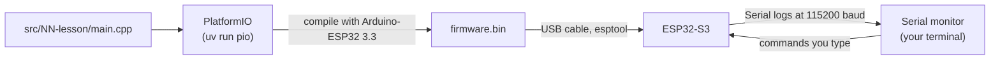
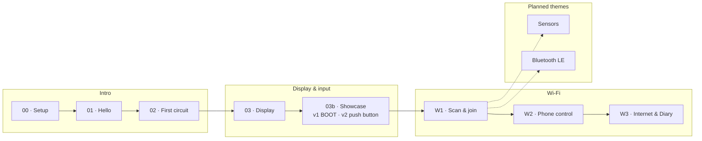
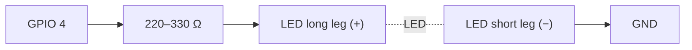
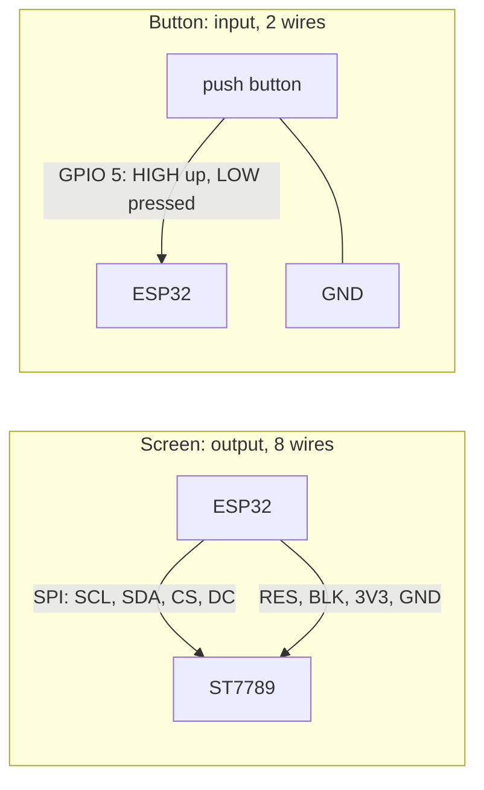
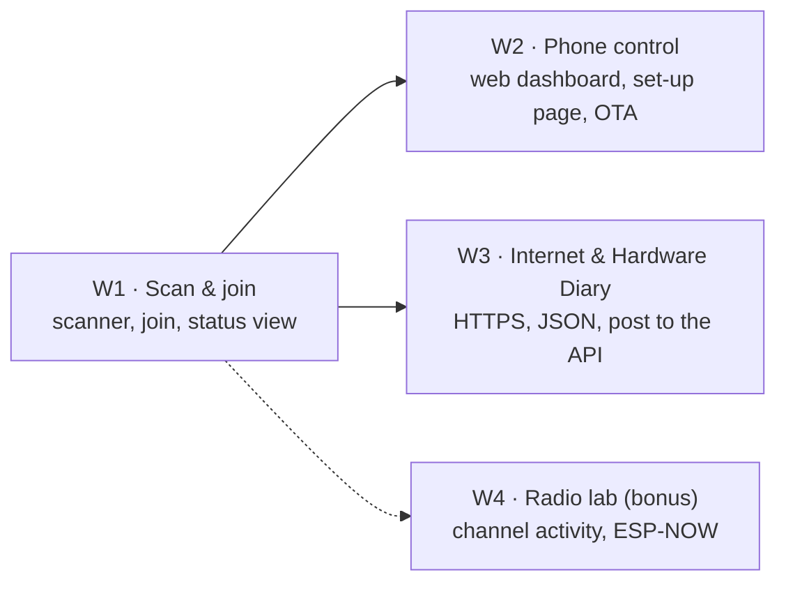

# test-esp: ESP32-S3 learning bench

A hands-on, step-by-step exploration of the **ESP32-S3-N16R8**. We work through it together: Claude writes the code, you wire, flash and report what you see.

This folder is a standalone sandbox. It is not part of the pnpm workspace, and the root lint and format tooling skips it, so nothing here affects `apps/` or `packages/`. Anything that proves useful can be moved into the main project later.

**[HARDWARE_LOG.md](HARDWARE_LOG.md)** records every command run on the board or that installs software, with its output, plus an overview of the board and what is flashed on it right now.

**[guide/bench-guide.html](guide/bench-guide.html)** is the source of the interactive [bench guide](https://claude.ai/artifact/TRr7C3mgC4YahK3XKt3y7r): pinout, wiring diagrams, lesson previews and the bench log. Edit it here, then republish it to the same link. Open it in a browser to use it offline.

## Kit

| Part                        | Notes                                                                                                                                |
| --------------------------- | ------------------------------------------------------------------------------------------------------------------------------------ |
| ESP32-S3-N16R8 DevKitC      | 16 MB flash, 8 MB octal PSRAM, dual-core 240 MHz, Wi-Fi + BLE, on-board RGB LED                                                      |
| 1.9" IPS TFT, 170 × 320     | ST7789 driver, SPI, 8 pins: GND VCC SCL SDA RES DC CS BLK                                                                            |
| Breadboard, jumper cables   | male-to-male for the breadboard, female-to-male for the display header                                                               |
| LEDs                        | long leg = **+** (anode), short leg = **−** (cathode)                                                                                |
| 220–330 Ω resistor (needed) | Protects the LED and the pin. Not in the kit list yet: most LED kits include some. Lesson 02 lowers the pin's drive as a safety net. |

## Toolchain



- **PlatformIO 6.2.0** (pinned in `pyproject.toml`, installed by `uv`), so nothing global is installed.
- **pioarduino platform 55.03.312-1**, which ships **Arduino-ESP32 3.3.12** (ESP-IDF 5.5.5). Pinned in `platformio.ini`.
- Board definition `esp32-s3-devkitc1-n16r8`: flash size, PSRAM mode and partition table already match the hardware.

### Commands

Run them from this folder (`cd test-esp`).

```sh
uv sync                                     # once: installs PlatformIO into .venv
uv run pio device list                      # which serial port is the board on?
uv run pio run -e 01-hello -t upload        # compile + flash a lesson
uv run pio device monitor                   # watch the logs (Ctrl+C to quit)
uv run pio run -e 01-hello -t upload -t monitor   # both in one go
ESP_PORT=/dev/cu.usbmodem1101 uv run pio run -e 01-hello -t upload   # force a port
```

## Course map

Lessons are grouped into themes. The guide shows the same themes as its top row; a new theme is one entry in its `TRACKS` list plus `track: "<id>"` on each lesson.



| Theme           | #   | Lesson                | Environment           | Status   | You learn                                                                |
| --------------- | --- | --------------------- | --------------------- | -------- | ------------------------------------------------------------------------ |
| Intro           | 00  | Setup                 | none                  | works    | USB ports, drivers, flashing, the serial monitor                         |
| Intro           | 01  | Hello                 | `01-hello`            | works    | `setup()`/`loop()`, logging, `millis()`, the RGB LED                     |
| Intro           | 02  | First circuit         | `02-led`              | works    | breadboards, resistors, GPIO, PWM, a state machine                       |
| Display & input | 03  | Display               | `03-display`          | works    | SPI, RGB565 colours, frame buffers in PSRAM                              |
| Display & input | 03b | Showcase, variation 1 | `03b-showcase`        | works    | 3D projection, lookup tables, particles, internal RAM vs PSRAM, timing   |
| Display & input | 03b | Showcase, variation 2 | `03b-showcase-button` | on board | inputs vs outputs, pull-ups, interrupts, debouncing, gestures            |
| Wi-Fi           | W1  | Scanner               | `w1-scan`             | built    | station mode, channels, RSSI in dBm, security types, background scanning |
| Wi-Fi           | W2+ | Join and beyond       | none                  | planned  | see the Wi-Fi track below                                                |
| Sensors         |     |                       |                       | planned  | I2C sensors (BME280), data over Wi-Fi                                    |
| Bluetooth LE    |     |                       |                       | planned  | BLE advertising, talking to a phone                                      |

## Lesson 00: setup

1. Plug the board into the Mac with a **data** USB-C cable (some cables only charge).
2. Use the port labelled **COM** (or **UART**). The serial logs in these lessons go through it. If your board only has one port, tell Claude: the native USB port needs one extra build flag.
3. Run `uv run pio device list`. You should see a new `/dev/cu.usbserial…`, `/dev/cu.usbmodem…` or `/dev/cu.wchusbserial…` entry. This board shows up as `/dev/cu.usbserial-A5069RR4` (FTDI FT232R USB-to-serial chip).
4. If flashing fails with "Failed to connect": hold **BOOT**, tap **RST**, release **BOOT**, and try again.

## Lesson 01: hello

Nothing to wire. Flash `01-hello` and open the monitor. Expected:

- An identity card that reports **16 MB flash** and **~8 MB PSRAM**.
- The on-board RGB LED slowly cycles through a rainbow.
- An `alive for Ns` line every 5 seconds.

No colour? Some boards use GPIO 38 for the RGB LED. Change `PIN_RGB` in `include/pins.h`.

## Lesson 02: first circuit



Type commands into the monitor: `on`, `off`, `blink 200`, `fade`, `sos`, `level 60`, `help`.

## Lesson 03: display

| Display pin | ESP32-S3              | Role                  |
| ----------- | --------------------- | --------------------- |
| GND         | GND (bottom-left pin) | ground                |
| VCC         | 3V3 (top-left pin)    | power (3.3 V)         |
| SCL         | GPIO 12               | SPI clock             |
| SDA         | GPIO 11               | SPI data (MOSI)       |
| RES         | GPIO 8                | reset                 |
| DC          | GPIO 9                | data/command select   |
| CS          | GPIO 10               | chip select           |
| BLK         | GPIO 7                | backlight (HIGH = on) |

The screen shows red/green/blue bars first, then a live sine-wave "bench scope" with uptime and frames per second.

## Lesson 03b: display showcase

Same display wiring as lesson 03. Four scenes: a shaded 3D torus, a per-pixel plasma, fireworks with fading trails, and a live dashboard (chip temperature, RAM, PSRAM, frame times). The frame buffer lives in fast internal RAM when a big enough block is free. The HUD and the serial log show fps, draw ms and send ms. Serial commands in both variations: `next`, `prev`, `scene <1-4>`, `auto on|off`, `hud`, `help`.

|                        | Variation 1                           | Variation 2                                                              |
| ---------------------- | ------------------------------------- | ------------------------------------------------------------------------ |
| Environment            | `03b-showcase`                        | `03b-showcase-button`                                                    |
| Extra wiring           | none                                  | push button: GPIO 5 and GND                                              |
| Controls               | BOOT: click = next, hold = auto-cycle | button or BOOT: click = next, double-click = previous, hold = auto-cycle |
| How the button is read | polled once per frame                 | interrupt on every edge, debounced, bounces counted                      |
| Code                   | `controls/boot_only.cpp`              | `controls/with_button.cpp`                                               |

`main.cpp` only knows actions (next, previous, toggle auto-cycle). `controls.h` is the contract, and each variation's `build_src_filter` compiles exactly one implementation.



**Wiring the push button (variation 2):** put it across the breadboard's centre gap. Wire one leg to the ESP32's **pin 5**, and the **diagonally opposite** leg to any **GND**. This bench uses a screw-terminal expansion board, so both wires end on its sockets labelled 5 and GND; breadboard holes are not connected to the ESP32. (With the board plugged into a breadboard instead, use a free hole in the pin's row.) Pins 4 and 5 sit side by side, so check the label. No resistor: the chip's internal pull-up holds the pin HIGH, and pressing pulls it LOW.

## Wi-Fi track

The ESP32-S3 radio is 2.4 GHz only (802.11 b/g/n): 5 GHz networks never show up. All Wi-Fi labs grow **one firmware**, `wifi-lab` (`uv run pio run -e wifi-lab -t upload`). Each lab adds features instead of starting over.



### Lab W1: Scan & join

Same wiring as 03b variation 2 (screen, push button on pin 5, BOOT).

- **Views:** networks (bars, name, channel, lock, dBm) · channels (each network as a hump over the ~4.4 channels its 22 MHz signal covers; 1, 6 and 11 don't overlap) · radar (stronger = closer) · status (clock from internet time, IP, `bench.local`, 60 s signal chart; opens by itself once joined).
- **Joining:** in the serial monitor, `join <#>` with the number from the scan table, then the password on the next line. It is stored in NVS on the chip, never in code, git or the log (only its length is logged). It rejoins after power-off; `forget` erases it.
- **Button or BOOT:** click = next view, double-click = scan now, hold = auto-scan every 10 s on/off.
- **Serial:** `scan`, `view <1-4>`, `auto on|off`, `join <#>`, `forget`, `reconnect`, `status`, `tz <POSIX TZ>` (default Central European time), `help`.
- **Disconnects** are logged with a plain-language reason ("wrong password?", "network not found"); it retries every 30 s.
- The monitor shows your neighbours' network names and what you type, including the password. Keep that out of anything shared; this repo's log records counts only.

## Between lessons

1. `Ctrl+C` closes the serial monitor on the Mac (frees the port). The program on the ESP32 keeps running and the screen stays on.
2. Unplug USB. This is what stops the program: board and screen switch off; nothing needs shutting down, and the program stays in flash.
3. Change the wiring while everything is off.
4. Check: screen VCC on 3V3, no loose or touching wires.
5. Plug back in and flash the next lesson. The upload replaces the old program.

Never unplug during `Writing at 0x…` (if it happens, just flash again; the ROM bootloader cannot be damaged). If a pin changes from output to input (for example, a button on a pin an old lesson drove HIGH), flash the new program first, then wire the part.

## Pins to avoid

| GPIO         | Why                                       |
| ------------ | ----------------------------------------- |
| 0, 3, 45, 46 | strapping pins: they decide how it boots  |
| 19, 20       | native USB D− / D+                        |
| 26–32        | connected to the flash chip               |
| 33–37        | connected to the octal PSRAM (the "R8")   |
| 43, 44       | UART0 TX / RX, used by the serial monitor |

Safe for experiments: 1, 2, 4–18, 21, 38–42, 47, 48 (48 is the RGB LED).

## Session log

| Date       | Step | What happened                                                                                                                                               |
| ---------- | ---- | ----------------------------------------------------------------------------------------------------------------------------------------------------------- |
| 2026-10-11 | 00   | Project created, lessons 01–03 compile. Waiting for first flash.                                                                                            |
| 2026-10-11 | 00   | Board found on `/dev/cu.usbserial-A5069RR4` (FT232R). esptool: ESP32-S3 rev v0.2, 8 MB embedded PSRAM, 16 MB quad flash.                                    |
| 2026-10-11 | 01   | Flashed `01-hello`. Identity card: 16 MB flash, 8 MB PSRAM, 337 KB free heap, SDK v5.5.5. Heartbeat every 5 s. RGB LED cycles colours, so GPIO 48 is right. |
| 2026-10-11 | 02   | You flashed `02-led`. The breadboard LED lights up: circuit wired correctly.                                                                                |
| 2026-10-11 | 03   | You flashed `03-display`. Screen works: colour check OK, bench scope at 22 fps.                                                                             |
