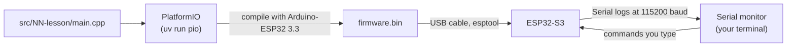
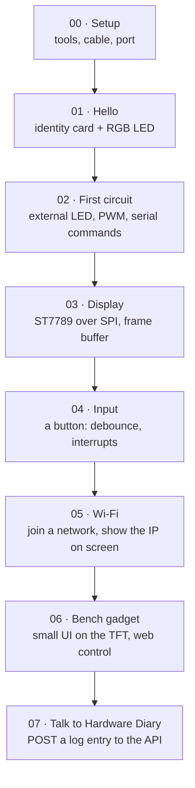
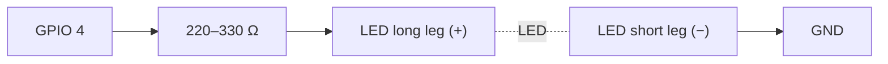

# test-esp: ESP32-S3 learning bench

A hands-on, step-by-step exploration of the **ESP32-S3-N16R8**. We work through it together: Claude writes the code, you wire, flash and report what you see.

This folder is a standalone sandbox. It is not part of the pnpm workspace, and the root lint and format tooling skips it, so nothing here affects `apps/` or `packages/`. Anything that proves useful can be moved into the main project later.

## Kit

| Part                        | Notes                                                                                                                                |
| --------------------------- | ------------------------------------------------------------------------------------------------------------------------------------ |
| ESP32-S3-N16R8 DevKitC      | 16 MB flash, 8 MB octal PSRAM, dual-core 240 MHz, Wi-Fi + BLE, on-board RGB LED                                                      |
| 1.9" IPS TFT, 170 × 320     | ST7789 driver, SPI, 8 pins: GND VCC SCL SDA RES DC CS BLK                                                                            |
| Breadboard, jumper cables   | male-to-male for the breadboard, female-to-male for the display header                                                               |
| LEDs                        | long leg = **+** (anode), short leg = **−** (cathode)                                                                                |
| 220–330 Ω resistor (needed) | Protects the LED and the pin. Not in the kit list yet: most LED kits include some. Lesson 02 lowers the pin's drive as a safety net. |

## Toolchain



- **PlatformIO 6.2.0** (pinned in `pyproject.toml`, installed by `uv`), so nothing global is installed.
- **pioarduino platform 55.03.312-1**, which ships **Arduino-ESP32 3.3.12** (ESP-IDF 5.5.5). Pinned in `platformio.ini`.
- Board definition `esp32-s3-devkitc1-n16r8`: flash size, PSRAM mode and partition table already match the hardware.

### Commands

Run them from this folder (`cd test-esp`).

```sh
uv sync                                     # once: installs PlatformIO into .venv
uv run pio device list                      # which serial port is the board on?
uv run pio run -e 01-hello -t upload        # compile + flash a lesson
uv run pio device monitor                   # watch the logs (Ctrl+C to quit)
uv run pio run -e 01-hello -t upload -t monitor   # both in one go
ESP_PORT=/dev/cu.usbmodem1101 uv run pio run -e 01-hello -t upload   # force a port
```

## Course map



| #   | Lesson        | Environment  | Status  | You learn                                              |
| --- | ------------- | ------------ | ------- | ------------------------------------------------------ |
| 00  | Setup         | none         | next    | USB ports, drivers, flashing, the serial monitor       |
| 01  | Hello         | `01-hello`   | ready   | `setup()`/`loop()`, logging, `millis()`, the RGB LED   |
| 02  | First circuit | `02-led`     | ready   | breadboards, resistors, GPIO, PWM, a state machine     |
| 03  | Display       | `03-display` | ready   | SPI, RGB565 colours, frame buffers in PSRAM            |
| 04+ | Later         | none         | planned | written once the earlier lessons work on your hardware |

## Lesson 00: setup

1. Plug the board into the Mac with a **data** USB-C cable (some cables only charge).
2. Use the port labelled **COM** (or **UART**). The serial logs in these lessons go through it. If your board only has one port, tell Claude: the native USB port needs one extra build flag.
3. Run `uv run pio device list`. You should see a new `/dev/cu.usbmodem…` or `/dev/cu.wchusbserial…` entry.
4. If flashing fails with "Failed to connect": hold **BOOT**, tap **RST**, release **BOOT**, and try again.

## Lesson 01: hello

Nothing to wire. Flash `01-hello` and open the monitor. Expected:

- An identity card that reports **16 MB flash** and **~8 MB PSRAM**.
- The on-board RGB LED slowly cycles through a rainbow.
- An `alive for Ns` line every 5 seconds.

No colour? Some boards use GPIO 38 for the RGB LED. Change `PIN_RGB` in `include/pins.h`.

## Lesson 02: first circuit



Type commands into the monitor: `on`, `off`, `blink 200`, `fade`, `sos`, `level 60`, `help`.

## Lesson 03: display

| Display pin | ESP32-S3 | Role                  |
| ----------- | -------- | --------------------- |
| GND         | GND      | ground                |
| VCC         | 3V3      | power (3.3 V)         |
| SCL         | GPIO 12  | SPI clock             |
| SDA         | GPIO 11  | SPI data (MOSI)       |
| RES         | GPIO 8   | reset                 |
| DC          | GPIO 9   | data/command select   |
| CS          | GPIO 10  | chip select           |
| BLK         | GPIO 7   | backlight (HIGH = on) |

The screen shows red/green/blue bars first, then a live sine-wave "bench scope" with uptime and frames per second.

## Pins to avoid

| GPIO         | Why                                       |
| ------------ | ----------------------------------------- |
| 0, 3, 45, 46 | strapping pins: they decide how it boots  |
| 19, 20       | native USB D− / D+                        |
| 26–32        | connected to the flash chip               |
| 33–37        | connected to the octal PSRAM (the "R8")   |
| 43, 44       | UART0 TX / RX, used by the serial monitor |

Safe for experiments: 1, 2, 4–18, 21, 38–42, 47, 48 (48 is the RGB LED).

## Session log

| Date       | Step | What happened                                                    |
| ---------- | ---- | ---------------------------------------------------------------- |
| 2026-10-11 | 00   | Project created, lessons 01–03 compile. Waiting for first flash. |
