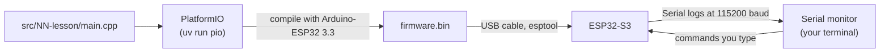
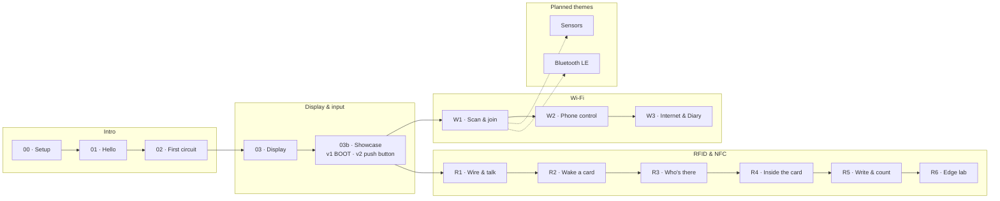
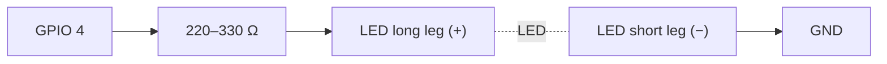
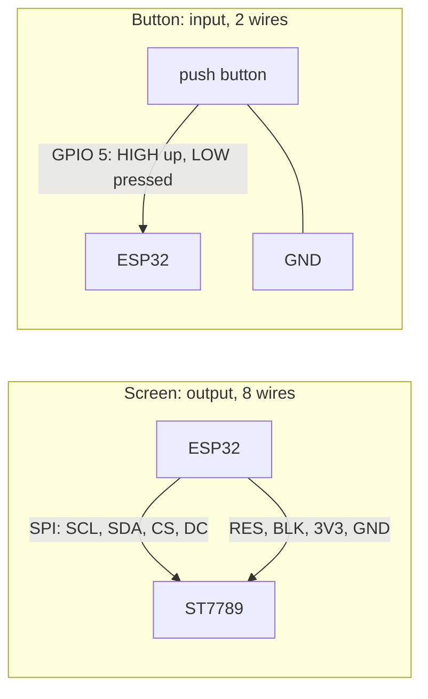
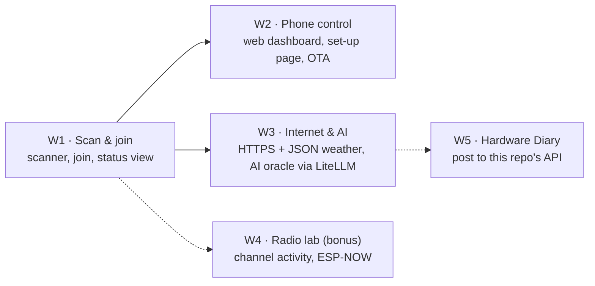
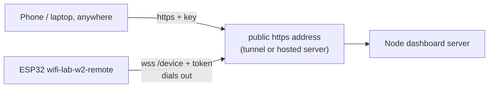
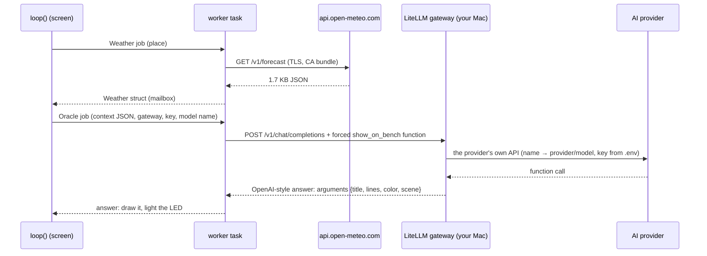
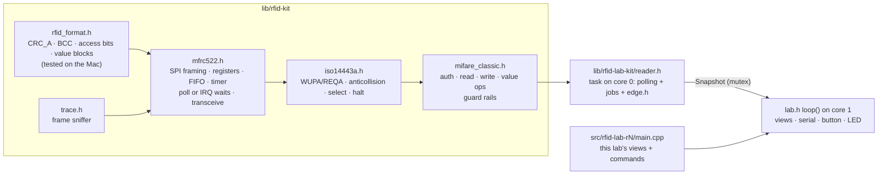

# test-esp: ESP32-S3 learning bench

A hands-on, step-by-step exploration of the **ESP32-S3-N16R8**. We work through it together: Claude writes the code, you wire, flash and report what you see.

This folder is a standalone sandbox. It is not part of the pnpm workspace, and the root lint and format tooling skips it, so nothing here affects `apps/` or `packages/`. Anything that proves useful can be moved into the main project later.

**[HARDWARE_LOG.md](HARDWARE_LOG.md)** records every command run on the board or that installs software, with its output, plus an overview of the board and what is flashed on it right now.

**[guide/bench-guide.html](guide/bench-guide.html)** is the source of the interactive [bench guide](https://claude.ai/artifact/TRr7C3mgC4YahK3XKt3y7r): pinout, wiring diagrams, lesson previews and the bench log. Edit it here, then republish it to the same link. Open it in a browser to use it offline.

## Kit

| Part                        | Notes                                                                                                                                |
| --------------------------- | ------------------------------------------------------------------------------------------------------------------------------------ |
| ESP32-S3-N16R8 DevKitC      | 16 MB flash, 8 MB octal PSRAM, dual-core 240 MHz, Wi-Fi + BLE, on-board RGB LED                                                      |
| 1.9" IPS TFT, 170 × 320     | ST7789 driver, SPI, 8 pins: GND VCC SCL SDA RES DC CS BLK                                                                            |
| RC522 RFID reader           | NXP MFRC522, 13.56 MHz, SPI, **3.3 V only**; comes with a white MIFARE Classic 1K card and a key tag                                 |
| Breadboard, jumper cables   | male-to-male for the breadboard, female-to-male for the display header                                                               |
| LEDs                        | long leg = **+** (anode), short leg = **−** (cathode)                                                                                |
| 220–330 Ω resistor (needed) | Protects the LED and the pin. Not in the kit list yet: most LED kits include some. Lesson 02 lowers the pin's drive as a safety net. |

## Toolchain



- **PlatformIO 6.2.0** (pinned in `pyproject.toml`, installed by `uv`), so nothing global is installed.
- **pioarduino platform 55.03.312-1**, which ships **Arduino-ESP32 3.3.12** (ESP-IDF 5.5.5). Pinned in `platformio.ini`.
- Board definition `esp32-s3-devkitc1-n16r8`: flash size, PSRAM mode and partition table already match the hardware.

### Commands

Run them from this folder (`cd test-esp`).

```sh
uv sync                                     # once: installs PlatformIO into .venv
uv run pio device list                      # which serial port is the board on?
uv run pio run -e 01-hello -t upload        # compile + flash a lesson
uv run pio device monitor                   # watch the logs (Ctrl+C to quit)
uv run pio run -e 01-hello -t upload -t monitor   # both in one go
ESP_PORT=/dev/cu.usbmodem1101 uv run pio run -e 01-hello -t upload   # force a port
```

## Course map

Lessons are grouped into themes. The guide shows the same themes as its top row; a new theme is one entry in its `TRACKS` list plus `track: "<id>"` on each lesson.



| Theme           | #     | Lesson                | Environment            | Status   | You learn                                                                            |
| --------------- | ----- | --------------------- | ---------------------- | -------- | ------------------------------------------------------------------------------------ |
| Intro           | 00    | Setup                 | none                   | works    | USB ports, drivers, flashing, the serial monitor                                     |
| Intro           | 01    | Hello                 | `01-hello`             | works    | `setup()`/`loop()`, logging, `millis()`, the RGB LED                                 |
| Intro           | 02    | First circuit         | `02-led`               | works    | breadboards, resistors, GPIO, PWM, a state machine                                   |
| Display & input | 03    | Display               | `03-display`           | works    | SPI, RGB565 colours, frame buffers in PSRAM                                          |
| Display & input | 03b   | Showcase, variation 1 | `03b-showcase`         | works    | 3D projection, lookup tables, particles, internal RAM vs PSRAM, timing               |
| Display & input | 03b   | Showcase, variation 2 | `03b-showcase-button`  | on board | inputs vs outputs, pull-ups, interrupts, debouncing, gestures                        |
| Wi-Fi           | W1    | Scan & join           | `wifi-lab-w1`          | built    | station mode, channels, RSSI in dBm, security types, NVS, NTP, mDNS                  |
| Wi-Fi           | W2    | Phone control         | `wifi-lab-w2(-remote)` | on board | REST, WebSocket, captive portal, OTA, relay through a tunnel                         |
| Wi-Fi           | W3    | Internet & AI         | `wifi-lab-w3`          | built    | HTTPS, JSON filters, worker tasks, AI function calling via LiteLLM                   |
| RFID & NFC      | R1–R7 | RFID labs             | `rfid-lab-r1` … `r7`   | R1 works | SPI registers, ISO 14443-A, anticollision, MIFARE memory, value blocks, edge testing |
| Sensors         |       |                       |                        | planned  | I2C sensors (BME280), data over Wi-Fi                                                |
| Bluetooth LE    |       |                       |                        | planned  | BLE advertising, talking to a phone                                                  |

## Lesson 00: setup

1. Plug the board into the Mac with a **data** USB-C cable (some cables only charge).
2. Use the port labelled **COM** (or **UART**). The serial logs in these lessons go through it. If your board only has one port, tell Claude: the native USB port needs one extra build flag.
3. Run `uv run pio device list`. You should see a new `/dev/cu.usbserial…`, `/dev/cu.usbmodem…` or `/dev/cu.wchusbserial…` entry. This board shows up as `/dev/cu.usbserial-A5069RR4` (FTDI FT232R USB-to-serial chip).
4. If flashing fails with "Failed to connect": hold **BOOT**, tap **RST**, release **BOOT**, and try again.

## Lesson 01: hello

Nothing to wire. Flash `01-hello` and open the monitor. Expected:

- An identity card that reports **16 MB flash** and **~8 MB PSRAM**.
- The on-board RGB LED slowly cycles through a rainbow.
- An `alive for Ns` line every 5 seconds.

No colour? Some boards use GPIO 38 for the RGB LED. Change `PIN_RGB` in `include/pins.h`.

## Lesson 02: first circuit



Type commands into the monitor: `on`, `off`, `blink 200`, `fade`, `sos`, `level 60`, `help`.

## Lesson 03: display

| Display pin | ESP32-S3              | Role                  |
| ----------- | --------------------- | --------------------- |
| GND         | GND (bottom-left pin) | ground                |
| VCC         | 3V3 (top-left pin)    | power (3.3 V)         |
| SCL         | GPIO 12               | SPI clock             |
| SDA         | GPIO 11               | SPI data (MOSI)       |
| RES         | GPIO 8                | reset                 |
| DC          | GPIO 9                | data/command select   |
| CS          | GPIO 10               | chip select           |
| BLK         | GPIO 7                | backlight (HIGH = on) |

The screen shows red/green/blue bars first, then a live sine-wave "bench scope" with uptime and frames per second.

## Lesson 03b: display showcase

Same display wiring as lesson 03. Four scenes: a shaded 3D torus, a per-pixel plasma, fireworks with fading trails, and a live dashboard (chip temperature, RAM, PSRAM, frame times). The frame buffer lives in fast internal RAM when a big enough block is free. The HUD and the serial log show fps, draw ms and send ms. Serial commands in both variations: `next`, `prev`, `scene <1-4>`, `auto on|off`, `hud`, `help`.

|                        | Variation 1                           | Variation 2                                                              |
| ---------------------- | ------------------------------------- | ------------------------------------------------------------------------ |
| Environment            | `03b-showcase`                        | `03b-showcase-button`                                                    |
| Extra wiring           | none                                  | push button: GPIO 5 and GND                                              |
| Controls               | BOOT: click = next, hold = auto-cycle | button or BOOT: click = next, double-click = previous, hold = auto-cycle |
| How the button is read | polled once per frame                 | interrupt on every edge, debounced, bounces counted                      |
| Code                   | `controls/boot_only.cpp`              | `controls/with_button.cpp`                                               |

`main.cpp` only knows actions (next, previous, toggle auto-cycle). `controls.h` is the contract, and each variation's `build_src_filter` compiles exactly one implementation.



**Wiring the push button (variation 2):** put it across the breadboard's centre gap. Wire one leg to the ESP32's **pin 5**, and the **diagonally opposite** leg to any **GND**. This bench uses a screw-terminal expansion board, so both wires end on its sockets labelled 5 and GND; breadboard holes are not connected to the ESP32. (With the board plugged into a breadboard instead, use a free hole in the pin's row.) Pins 4 and 5 sit side by side, so check the label. No resistor: the chip's internal pull-up holds the pin HIGH, and pressing pulls it LOW.

## Wi-Fi track

The ESP32-S3 radio is 2.4 GHz only (802.11 b/g/n): 5 GHz networks never show up. Each lab is **its own firmware with its own command**: `uv run pio run -e wifi-lab-w1 -t upload`, `-e wifi-lab-w2`, and so on. The code they share (scanner, connection, ping, screens) lives in [`lib/wifi-kit`](lib/wifi-kit/src), so a later lab adds features instead of copying. The saved network is shared too: switching labs keeps it.

Every lab needs the screen from lesson 03. The **push button on pin 5 is optional**: it does exactly what BOOT does, and with nothing wired the chip's internal pull-up keeps the pin quiet.



### Lab W1: Scan & join

`uv run pio run -e wifi-lab-w1 -t upload` · code in [`src/wifi-lab-w1`](src/wifi-lab-w1/main.cpp). Screen from lesson 03; push button on pin 5 optional (BOOT does the same).

- **Views:** networks (bars, name, channel, lock, dBm) · channels (each network as a hump over the ~4.4 channels its 22 MHz signal covers; 1, 6 and 11 don't overlap) · radar (stronger = closer) · status (clock from internet time, IP, `bench.local`, 60 s signal chart; opens by itself once joined).
- **Joining:** in the serial monitor, `join <#>` with the number from the scan table, then the password on the next line. It is stored in NVS on the chip, never in code, git or the log (only its length is logged). It rejoins after power-off; `forget` erases it.
- **Button or BOOT:** click = next view, double-click = scan now, hold = auto-scan on/off (every 10 s, every 60 s once joined: each scan takes the radio off your router's channel for ~3 s).
- **Serial:** `scan`, `view <1-4>`, `auto on|off`, `join <#>`, `forget`, `reconnect`, `status`, `tz <POSIX TZ>` (default Central European time), `ping` (the router) or `ping <ip>` (e.g. your computer), `help`.
- **Disconnects** are logged with a plain-language reason ("wrong password?", "network not found"); it retries every 30 s.
- The monitor shows your neighbours' network names and what you type, including the password. Keep that out of anything shared; this repo's log records counts only.

### Lab W2: Phone control

`uv run pio run -e wifi-lab-w2 -t upload` · code in [`src/wifi-lab-w2`](src/wifi-lab-w2/main.cpp). Same wiring as W1. Two variations, like 03b. **Variation 1 · on your Wi-Fi** is everything from W1, plus:

- **`http://bench.local`**: a phone page with status, screen view, brightness, auto-scan, a message for the screen, the LED colour, the networks, live button events and admin actions.
- **REST API** under `/api` (list at `/api`) and a **WebSocket** at `/ws` that pushes status every second, scan results, button presses and update progress.
- **Set-up network:** with no saved Wi-Fi (or after a minute of failed joins) the board also opens `bench-setup`. Its password is shown on the screen only. Join it from a phone and the set-up page opens by itself (captive portal); pick a network and type its password.
- **Firmware updates over HTTP** (`POST /api/ota`): written to the other app slot and verified before the reboot, so a failed upload changes nothing. The screen shows the progress.
- **Admin token:** reboot, forget Wi-Fi and firmware updates need `Authorization: Bearer <token>`. The board creates the token on first boot and keeps it in NVS; serial `token` shows it, `token new` replaces it. Everything else is open on your local network.
- **Serial:** new commands `setup` (open the set-up network), `token`, `token new`.

**Variation 2 · from anywhere** (`uv run pio run -e wifi-lab-w2-remote -t upload`): the same firmware plus a remote link. The board dials **out** to your dashboard server and keeps a secure WebSocket open (`wss://…/device`, signed in with its admin token), so you can drive it from anywhere and nothing opens on your router. The server needs a public https address: your Mac plus a tunnel (`pnpm remote` and `pnpm tunnel:cloudflare` or `pnpm tunnel:ngrok`), or the same app on a hosted server (VPS, Fly.io, Render…). The board only needs the address: serial `relay wss://<host>`, saved on the chip. The dashboard asks for a sign-in key (`DASHBOARD_KEY`) because it is public. A teal ring around the screen's link dot means the server is connected. Firmware updates stay with variation 1 for now. Details: [dashboard/README.md](dashboard/README.md#remote-control-relay-mode).



**If the page won't open** (what we found on this bench, in order):

1. Type the full address with `http://`: the board has no `https`.
2. Serial `ping` (the router) and `ping <your computer's IP>`. Router answers but your computer doesn't: the router keeps Wi-Fi devices apart. On a FRITZ!Box: WLAN → Sicherheit → tick "WLAN-Geräte dürfen untereinander kommunizieren".
3. Works on the phone but not in the Mac's browser: System Settings → Privacy & Security → Local Network → allow the browser (Chrome and Firefox need it; Safari doesn't).

**Desktop dashboard:** [`dashboard/`](dashboard/README.md) is a React + Node app (its own pnpm project). The Node server holds the token in `.env`, validates every request, relays the board's live stream and keeps 10 minutes of history; the React app shows live signal and temperature charts and every control above.

```sh
cd test-esp/dashboard && cp .env.example .env   # ESP_TOKEN = serial command `token`
pnpm install && pnpm dev                         # http://localhost:5173
```

### Lab W3: Internet & AI

`uv run pio run -e wifi-lab-w3 -t upload` · code in [`src/wifi-lab-w3`](src/wifi-lab-w3/main.cpp). Same wiring; push button optional. Uses the Wi-Fi network W1/W2 saved.

The board becomes an internet client. Every request runs in a worker task (`worker.h`), so the screen keeps animating while it waits, and the footer shows how the last one went (time, size).

- **Weather** from [Open-Meteo](https://open-meteo.com) (no account, no key): `city Hamburg` looks the city up and saves it on the chip; the weather refreshes every 15 minutes. One HTTPS request brings now, the next 24 hours and 7 days in about 1.7 KB of JSON; an ArduinoJson filter keeps only what the screen draws.
- **Views:** now (animated sky, temperature, feels-like, wind, humidity) · forecast (temperature line, and rain chance bars on their own scale) · week (each day's low-to-high range on one shared scale) · oracle · status.
- **The Bench Oracle:** the board sends an AI model what it knows about the moment as JSON: place, time, weather, its own temperature and signal. The request offers one function, `show_on_bench {title, lines, color, scene}`, and forces the model to call it, so the answer is always JSON the board can draw: a haiku (double-click in the oracle view, or hold the button anywhere) or an answer (`ask should I bike to work?`). The LED takes the colour the model picked; time and tokens show under the answer.
- **Any provider, through LiteLLM:** the board speaks one OpenAI-style API to the [AI gateway](ai-gateway/README.md) on your Mac (`ai url http://<Mac IP>:4000`, `ai key <LITELLM_MASTER_KEY>`). `ai-gateway/config.yaml` maps names to models: `oracle` (Claude Opus), `oracle-fast` (Claude Haiku), and whatever you add (OpenAI, Gemini, a local Ollama model). `ai model <name>` switches without reflashing. Provider keys stay in the gateway's `.env`; the board stores only the gateway key (NVS, never logged, last 4 characters shown; `ai key forget` erases it). At most one question per 10 s, and never on its own.
- **Serial:** `city <name>`, `weather`, `oracle`, `ask <question>`, `ai`, `ai url <url>`, `ai key <key>`, `ai key forget`, `ai model <name>`, `led off`, `view <1-5>`, `status`, `ping [ip]`, `tz <TZ>`, `reconnect`, `forget`, `help`.



## RFID track

Each lab is its own firmware with its own command, like the Wi-Fi labs:

| Lab                | Command                                   | Views              | Adds these serial commands                                                             |
| ------------------ | ----------------------------------------- | ------------------ | -------------------------------------------------------------------------------------- |
| R1 Wire & talk     | `uv run pio run -e rfid-lab-r1 -t upload` | chip · card        | `chip` `reset` `selftest` `loopback` `regs` `spi` `gain` `timeout` `irq`               |
| R2 Wake a card     | `uv run pio run -e rfid-lab-r2 -t upload` | + trace            | `poll` `trace`                                                                         |
| R3 Who's there     | `uv run pio run -e rfid-lab-r3 -t upload` | (same)             | `inventory`                                                                            |
| R4 Inside the card | `uv run pio run -e rfid-lab-r4 -t upload` | + memory           | `dump` `read`                                                                          |
| R5 Write & count   | `uv run pio run -e rfid-lab-r5 -t upload` | + credits          | `write` `credits`                                                                      |
| R6 Edge lab        | `uv run pio run -e rfid-lab-r6 -t upload` | + edge             | `edge`                                                                                 |
| R7 Card manager    | `uv run pio run -e rfid-lab-r7 -t upload` | door · cards · log | a bench door managed from the React app in [`door-app`](door-app/README.md) over Wi-Fi |

Each [`src/rfid-lab-rN/main.cpp`](src/rfid-lab-r1/main.cpp) is a short list: that lab's views (with what a double-click does on each) and its commands, so `help` shows exactly what the lesson teaches. The shared code is in [`lib/rfid-lab-kit`](lib/rfid-lab-kit/src): the reader task, the six screen views, the edge experiments, every command (`lab_commands.h`) and the lab shell (`lab.h`: screen, button, LED, serial). No RFID library: [`lib/rfid-kit`](lib/rfid-kit/src) is our own driver, written in layers so every byte stays visible. The reader runs in its own task on core 0 and owns the chip; `loop()` on core 1 only draws and parses commands.



**Wiring** (the screen stays as in lesson 03; the RC522 is on the S3's second SPI bus, SPI3, so it never shares with the screen):

| RC522 pin | ESP32-S3         | Role                                                                           |
| --------- | ---------------- | ------------------------------------------------------------------------------ |
| SDA       | GPIO 15          | chip select (NSS) in SPI mode, not I2C data                                    |
| SCK       | GPIO 16          | SPI clock                                                                      |
| MOSI      | GPIO 17          | ESP32 → chip                                                                   |
| MISO      | GPIO 18          | chip → ESP32                                                                   |
| IRQ       | GPIO 13          | optional; without it the firmware polls                                        |
| GND       | GND              | right header, top pin                                                          |
| RST       | GPIO 14          | reset; low = hard power-down                                                   |
| 3.3V      | 3V3 (second pin) | **never 5 V**: the MFRC522 is rated 2.5–3.6 V and its pins aren't 5 V tolerant |

**Views** (click to cycle, double-click runs the view's action, hold pauses polling): chip · card · trace · memory · credits · edge.

**On-board RGB LED:** a bright green flash every time a card is read (a new card, or a command reaching it) · steady green while a card is on the reader · red when the reader chip stops answering · off with no card.

| Step               | Serial commands                                                                                           | What you learn                                                                                                                                                                                                         |
| ------------------ | --------------------------------------------------------------------------------------------------------- | ---------------------------------------------------------------------------------------------------------------------------------------------------------------------------------------------------------------------- |
| R1 Wire & talk     | `chip`, `reset`, `selftest`, `loopback`, `regs`, `spi <MHz>`, `gain <0-7>`, `irq on\|off`, `timeout <us>` | the SPI address byte, registers, the FIFO, the datasheet self-test (64 bytes, section 16.1.1; clones such as the FM17522 run it twice and compare), what 00h / FFh mean, a 2 s watchdog that hard-resets a silent chip |
| R2 Wake a card     | `poll on\|off`, `trace on\|off`                                                                           | the 13.56 MHz field, 100 % ASK, load modulation, WUPA/ATQA, a polling task, sniffing frames                                                                                                                            |
| R3 Who's there     | `inventory` (card and tag together)                                                                       | bit collisions, the anticollision tree walk, NVB, BCC, cascade levels, SAK, HALT/WUPA                                                                                                                                  |
| R4 Inside the card | `dump`, `read <block>`                                                                                    | sectors, trailers, access bits (stored twice), 3-pass authentication inside the chip, encrypted frames                                                                                                                 |
| R5 Write & count   | `write <block> <text>`, `credits`, `credits init\|add\|use <n>`                                           | block writes with ACK/NAK, read-back checks, value blocks, INCREMENT/DECREMENT/TRANSFER, a backup block                                                                                                                |
| R6 Edge lab        | `edge spi`, `edge gain`, `edge timeout`, `edge timing`, `edge irq`, `edge crc`, `edge stress [n]`         | each setting pushed until it breaks: SPI clock vs the 10 MHz spec, gain vs distance, the card's ~86 µs reply time, per-step timing, IRQ vs polling, offloading the CRC, read reliability                               |

**R7 · Card manager** (`src/rfid-lab-r7`, app in [`door-app`](door-app/README.md)): the board keeps a list of up to 20 cards in NVS (name, role, blocked, end date, hours, uses left) and decides every tap itself; the card only brings its UID. A JSON API and a WebSocket on port 80 (the same web libraries as W2) let the React app add cards (tap within 20 s), edit and block them, copy one card's rules to another, replace a lost card (the new one takes over its rules, the old one is blocked), write a name label, wipe the lab data blocks, open a lock remotely and switch on lockdown, with a live access log. Two simulated locks: the front door (every role) and the admin room (admin cards only); the one reader is mounted at one of them at a time (app or serial `at front|admin`). Card data: save a card's lab blocks (4-6, 8-10) as a snapshot on the board (`snapshots.h`, up to 8 in NVS), write it back, copy a card onto another (two taps), compare a snapshot with the card on the reader, download and import snapshots as JSON files. A copy never moves block 0 or the trailers, so it stays a different card to the door. Every change needs the admin token (shared with W2, now in `lib/wifi-kit/src/api_token.h`); the app's Vite proxy adds it from `.env`, so the browser never holds it. Rule order in `access_rules.h`, checked on the Mac by `test/host/door_rules_test.cpp`.

**Guard rails:** the firmware only uses the factory key on your own cards; it never writes block 0 or a sector trailer (a trailer with broken access bits locks its sector for good), and it checks a block's access bits before writing. The key never goes into the trace.

**Host test** (no board): `c++ -std=c++17 -Wall -I lib/rfid-kit/src test/host/rfid_format_test.cpp -o /tmp/rfid_test && /tmp/rfid_test` checks CRC_A against frames every sniffer shows (`50 00 → 57 CD`, `30 00 → 02 A8`), access bits and value blocks.

The guide has the interactive side: a 3D model of the field and the card (with a range chart), a 3D memory map you open sector by sector, bit-level SPI and anticollision walk-throughs, access-bit and value-block decoders, step-by-step frame diagrams, and edge charts that plot the tables you paste from the monitor.

## Between lessons

1. `Ctrl+C` closes the serial monitor on the Mac (frees the port). The program on the ESP32 keeps running and the screen stays on.
2. Unplug USB. This is what stops the program: board and screen switch off; nothing needs shutting down, and the program stays in flash.
3. Change the wiring while everything is off.
4. Check: screen VCC on 3V3, no loose or touching wires.
5. Plug back in and flash the next lesson. The upload replaces the old program.

Never unplug during `Writing at 0x…` (if it happens, just flash again; the ROM bootloader cannot be damaged). If a pin changes from output to input (for example, a button on a pin an old lesson drove HIGH), flash the new program first, then wire the part.

## Pins to avoid

| GPIO         | Why                                       |
| ------------ | ----------------------------------------- |
| 0, 3, 45, 46 | strapping pins: they decide how it boots  |
| 19, 20       | native USB D− / D+                        |
| 26–32        | connected to the flash chip               |
| 33–37        | connected to the octal PSRAM (the "R8")   |
| 43, 44       | UART0 TX / RX, used by the serial monitor |

Safe for experiments: 1, 2, 4–18, 21, 38–42, 47, 48 (48 is the RGB LED).

## Session log

| Date       | Step | What happened                                                                                                                                               |
| ---------- | ---- | ----------------------------------------------------------------------------------------------------------------------------------------------------------- |
| 2026-10-11 | 00   | Project created, lessons 01–03 compile. Waiting for first flash.                                                                                            |
| 2026-10-11 | 00   | Board found on `/dev/cu.usbserial-A5069RR4` (FT232R). esptool: ESP32-S3 rev v0.2, 8 MB embedded PSRAM, 16 MB quad flash.                                    |
| 2026-10-11 | 01   | Flashed `01-hello`. Identity card: 16 MB flash, 8 MB PSRAM, 337 KB free heap, SDK v5.5.5. Heartbeat every 5 s. RGB LED cycles colours, so GPIO 48 is right. |
| 2026-10-11 | 02   | You flashed `02-led`. The breadboard LED lights up: circuit wired correctly.                                                                                |
| 2026-10-11 | 03   | You flashed `03-display`. Screen works: colour check OK, bench scope at 22 fps.                                                                             |
