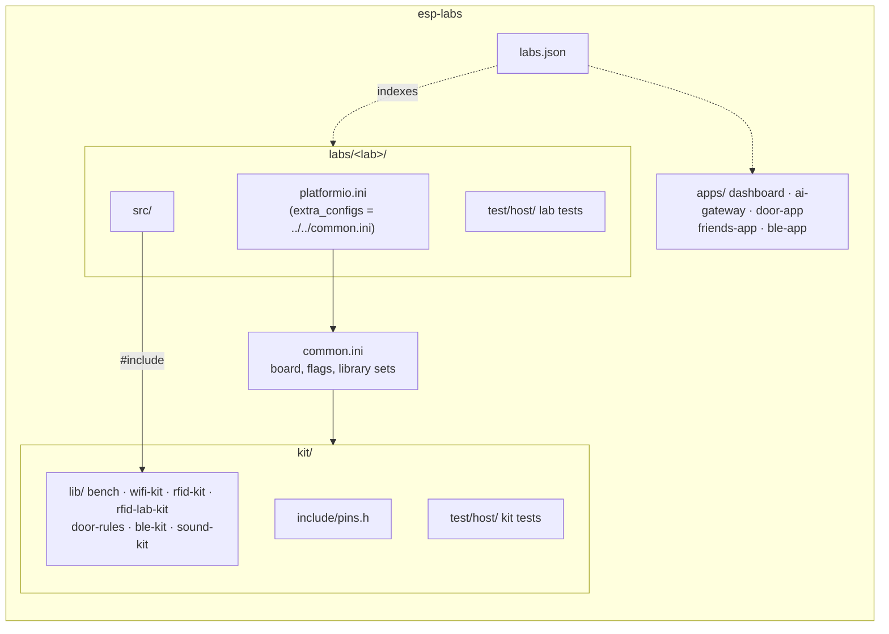

# esp-labs

ESP32-S3 learning labs, one standalone PlatformIO project per lab. It was extracted from `hardware-diary/test-esp`; the full course text is in [docs/course.md](docs/course.md).

Every lab builds on its own (`labs/<lab>`), shares board settings through [`common.ini`](common.ini) and pulls only the kit libraries it includes. [`labs.json`](labs.json) is the machine-readable index (tracks, labs, environments, kit libraries, companion apps, host tests): the learning dashboard links to labs through it. The bench guide, [esp-labs-web](https://github.com/agharsallah/esp-labs-web), is cloned next to this repo and reads the lab code from it at build time (`FIRMWARE_DIR=../esp-labs`).

## Layout



## Commands

Run from the repo root.

```sh
uv sync                                                    # once: PlatformIO 6.2.0 into .venv
uv run pio device list                                     # which serial port is the board on?
uv run pio run -d labs/01-hello                            # compile a lab (its default environment)
uv run pio run -d labs/01-hello -t upload -t monitor       # flash it and watch the logs
uv run pio run -d labs/wifi-lab-w2 -e wifi-lab-w2-remote   # a lab with several variations
ESP_PORT=/dev/cu.usbmodem1101 uv run pio run -d labs/01-hello -t upload   # force a port
./tools/host-tests.sh                                      # every host test, on the Mac, no board
```

Libraries and compiled objects are shared across labs in the root `.pio/` (`libdeps_dir`, `build_cache_dir`), so switching labs doesn't download or rebuild everything.

## Adding a lab

1. Create `labs/<lab>/src/main.cpp` and a `platformio.ini` like any other lab: `extra_configs = ../../common.ini`, one `[env:<lab>]`, and `lib_deps = ${display.lib_deps}` (or `json`, `web`, `relay`, `ble`).
2. Code shared by two labs goes into `kit/lib/<name>/src` with a `library.json`. A lab never includes another lab's files.
3. Add the lab to `labs.json` and give it a `README.md`.

## Labs

| Track | Lab | Environments | Kit | App |
| ----- | --- | ------------ | --- | --- |
| Intro | [Meet the board](labs/01-hello/README.md) | `01-hello` | none | none |
| Intro | [First circuit](labs/02-led/README.md) | `02-led` | none | none |
| Display & input | [The 1](labs/03-display/README.md) | `03-display` | none | none |
| Display & input | [Variation 1](labs/03b-showcase/README.md) | `03b-showcase`, `03b-showcase-button` | bench | none |
| Display & input | [Diagnostic](labs/pin-check/README.md) | `pin-check` | none | none |
| Wi-Fi | [W1 Scan & join](labs/wifi-lab-w1/README.md) | `wifi-lab-w1` | bench, wifi-kit | none |
| Wi-Fi | [W2 Phone control, variation 1](labs/wifi-lab-w2/README.md) | `wifi-lab-w2`, `wifi-lab-w2-remote` | bench, wifi-kit | [dashboard](apps/dashboard/README.md) |
| Wi-Fi | [W3 Internet & AI](labs/wifi-lab-w3/README.md) | `wifi-lab-w3` | bench, wifi-kit | [ai-gateway](apps/ai-gateway/README.md) |
| RFID & NFC | [R1 Wire & talk](labs/rfid-lab-r1/README.md) | `rfid-lab-r1` | rfid-lab-kit | none |
| RFID & NFC | [R2 Wake a card](labs/rfid-lab-r2/README.md) | `rfid-lab-r2` | rfid-lab-kit | none |
| RFID & NFC | [R3 Who's there](labs/rfid-lab-r3/README.md) | `rfid-lab-r3` | rfid-lab-kit | none |
| RFID & NFC | [R4 Inside the card](labs/rfid-lab-r4/README.md) | `rfid-lab-r4` | rfid-lab-kit | none |
| RFID & NFC | [R5 Write & count](labs/rfid-lab-r5/README.md) | `rfid-lab-r5` | rfid-lab-kit | none |
| RFID & NFC | [R6 Edge lab](labs/rfid-lab-r6/README.md) | `rfid-lab-r6` | rfid-lab-kit | none |
| RFID & NFC | [R7 Card manager](labs/rfid-lab-r7/README.md) | `rfid-lab-r7` | bench, door-rules, rfid-kit, wifi-kit | [door-app](apps/door-app/README.md) |
| RFID & NFC | [R8 Card friends](labs/rfid-lab-r8/README.md) | `rfid-lab-r8` | bench, door-rules, rfid-kit, wifi-kit | [friends-app](apps/friends-app/README.md) |
| RFID & NFC | [R9 Vault (work in progress)](labs/rfid-lab-r9/README.md) | not wired yet | bench, rfid-kit, wifi-kit | none |
| Bluetooth LE | [B1 Listen](labs/ble-lab-b1/README.md) | `ble-lab-b1` | bench, ble-kit | none |
| Bluetooth LE | [B2 Be seen](labs/ble-lab-b2/README.md) | `ble-lab-b2` | bench, ble-kit | none |
| Bluetooth LE | [B3 Connect & talk](labs/ble-lab-b3/README.md) | `ble-lab-b3` | bench, ble-kit | none |
| Bluetooth LE | [B4 Pair & trust](labs/ble-lab-b4/README.md) | `ble-lab-b4` | bench, ble-kit | none |
| Bluetooth LE | [B5 Phone app](labs/ble-lab-b5/README.md) | `ble-lab-b5` | bench, ble-kit | [ble-app](apps/ble-app/README.md) |
| Bluetooth LE | [B6 Keyboard & media](labs/ble-lab-b6/README.md) | `ble-lab-b6` | bench, ble-kit | none |
| Bluetooth LE | [B7 Music](labs/ble-lab-b7/README.md) | `ble-lab-b7` | bench, ble-kit | [ble-app](apps/ble-app/README.md) |
| Bluetooth LE | [B8 Host](labs/ble-lab-b8/README.md) | `ble-lab-b8` | bench, ble-kit | none |
| Sound | [S1 Hear](labs/sound-lab-s1/README.md) | `sound-lab-s1` | bench, sound-kit | none |
| Sound | [S2 Loudness](labs/sound-lab-s2/README.md) | `sound-lab-s2` | bench, sound-kit | none |
| Sound | [S3 Clap control](labs/sound-lab-s3/README.md) | `sound-lab-s3` | bench, sound-kit | none |
| Sound | [S4 Recorder](labs/sound-lab-s4/README.md) | `sound-lab-s4` | bench, sound-kit, wifi-kit | none |
| Sound | [S5 Spectrum](labs/sound-lab-s5/README.md) | `sound-lab-s5` | bench, sound-kit | none |
| Sound | [S6 Sound games](labs/sound-lab-s6/README.md) | `sound-lab-s6` | bench, sound-kit | none |
| Sound | [S7 Speaker](labs/sound-lab-s7/README.md) | `sound-lab-s7` | bench, sound-kit | none |
| Sound | [S8 Voice FX](labs/sound-lab-s8/README.md) | `sound-lab-s8` | bench, sound-kit | none |
