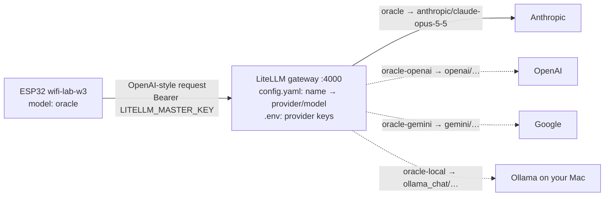

# Bench AI gateway (LiteLLM)

The Bench Oracle on the ESP32 (lab W3, `wifi-lab-w3`) never calls an AI provider directly. It sends one OpenAI-style request (`POST /v1/chat/completions` with a forced function call) to this gateway, and [LiteLLM](https://docs.litellm.ai) forwards it to whichever provider and model the name maps to.



Why a gateway:

- **Any provider, no reflash.** Add a provider in `config.yaml`, then on the board: `ai model <name>`.
- **Provider keys stay on this machine** (`.env`), never on the chip. The board only knows the gateway's key.
- **One format for the board.** LiteLLM translates the OpenAI-style request, including the forced function call, into each provider's own API.

## Run it

```sh
cd esp-labs/apps/ai-gateway
cp .env.example .env          # LITELLM_MASTER_KEY (starts with sk-) + the provider keys you use
uv sync                       # installs litellm[proxy], pinned, into .venv
uv run --env-file .env litellm --config config.yaml --port 4000
```

Then on the board (serial monitor), with your Mac's IP address (`ipconfig getifaddr en0`):

```text
ai url http://192.168.178.31:4000
ai key sk-bench-...            (the LITELLM_MASTER_KEY)
ai model oracle                (or oracle-fast, or any model_name from config.yaml)
```

Check it from the Mac first:

```sh
curl -s http://localhost:4000/v1/models -H "Authorization: Bearer $LITELLM_MASTER_KEY"
```

## Notes

- **Tools.** The oracle needs function calling. Most current hosted models support it; for local models, pick one that does.
- **Network.** On your home Wi-Fi the board talks plain `http` to the gateway, so the gateway key crosses your Wi-Fi unencrypted. To reach the gateway from anywhere, put it behind a tunnel or a hosted server with `https` (as in W2 variation 2) and use `ai url https://…`.
- **Cost.** Set a monthly spend limit at each provider. The board asks at most once per 10 s and never on its own.
- **Version.** `litellm[proxy]==1.101.2` is pinned to a release at least two weeks old, because malicious LiteLLM versions were published to PyPI in 2026. `uv.lock` records the hash of every file.
