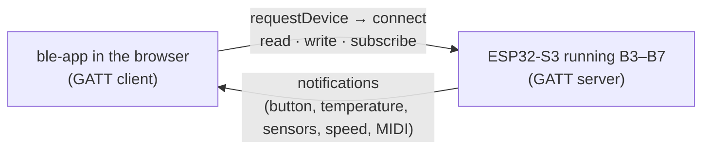

# Bench radio (ble-app)

A small React app for the Bluetooth LE labs. It talks to the board **directly over Bluetooth** with
Web Bluetooth: no Wi-Fi, no server, no proxy. Vite only serves the page.



## Tabs

| Tab     | Works with                         | What it does                                                                                                                                          |
| ------- | ---------------------------------- | ----------------------------------------------------------------------------------------------------------------------------------------------------- |
| Connect | any lab B3–B7, any BLE-MIDI device | The browser's device chooser, a live GATT explorer (services, characteristics, properties) and every operation byte by byte.                          |
| Control | B3, B4, B5                         | Colour wheel → LED (`ba5e0001`), message → screen (`ba5e0002`, 40 bytes of UTF-8), button notifications (`ba5e0003`), temperature chart (`ba5e0004`). |
| Sketch  | B5                                 | Draw with a finger or mouse; strokes go to Canvas (`ba5e0010`) as writes without response and appear on the board's sketch view.                      |
| Live    | B5                                 | Sensors (`ba5e0011`) every 200 ms: temperature, touch on GPIO 1, free heap, link RSSI.                                                                |
| Speed   | B5                                 | Throughput test (`ba5e0012`) plus link controls (`ba5e0013`: fast/slow interval, 2M PHY, long packets).                                               |
| Music   | B7, any BLE-MIDI instrument        | A piano that sends BLE-MIDI notes, a WebAudio synth that plays the board's notes, and a piano roll. Computer keys A W S E D F T G Y H U J K play too. |

The strip under the header shows every operation crossing the air, in the board's colours:
blue write, violet notify, teal read, amber subscribe, coral trouble.

## Run it

```bash
cd esp-labs/apps/ble-app
pnpm install
pnpm dev                 # http://localhost:5177
```

Web Bluetooth needs a **secure page** and a **Chromium browser**:

- **Mac**: Chrome or Edge at `http://localhost:5177` (localhost counts as secure). The first time,
  macOS asks to allow Chrome to use Bluetooth (System Settings → Privacy & Security → Bluetooth).
- **Android**: the phone needs https. Run `pnpm tunnel` in a second terminal (cloudflared, no
  account) and open the printed `https://…trycloudflare.com` address in Chrome. Bluetooth on;
  Android may also want Location on for scanning.
- **iPhone / iPad**: Safari has no Web Bluetooth. Install the free **Bluefy** browser and open the
  tunnel's https address in it.
- Firefox and Safari show a screen that says exactly this.

`pnpm build` + `pnpm preview` serves the built app on the same port. `pnpm test` checks the byte
encoders (sketch protocol, BLE-MIDI, sensors, speed) against the firmware's documented formats.

## Formats

The byte formats are documented next to the firmware that reads them:
`labs/ble-lab-b5/src/canvas_protocol.h` (sketch), `labs/ble-lab-b5/src/extras.h` (sensors, speed, link) and
`kit/lib/ble-kit/src/bench_service.h` (LED, message, button, temperature).
