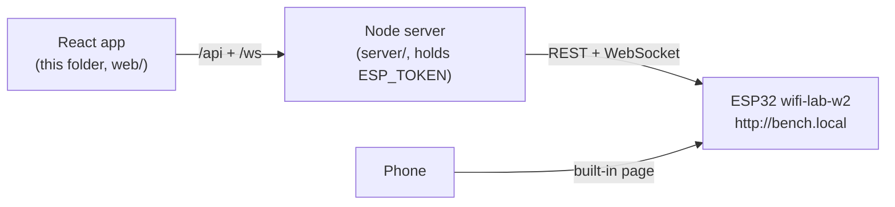
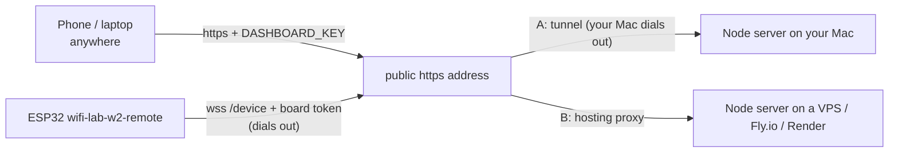

# Bench dashboard

A desktop dashboard for the ESP32 `wifi-lab-w2` firmware (lab W2), on your Wi-Fi or from anywhere. It shows live signal and chip temperature, the networks around the board and button presses as they happen. It also controls the screen (view, brightness, a message), the on-board LED and admin actions (reboot, forget Wi-Fi, firmware update).



That is **LAN mode** (`ESP_MODE=lan`, firmware `wifi-lab-w2`): the server dials the board. The browser only ever talks to the Node server. The server validates every request, adds the admin token for admin actions, relays the board's live stream to every open browser and keeps 10 minutes of history for the charts. The token never reaches the browser.

## Run it

```sh
cd esp-labs/apps/dashboard
cp .env.example .env     # then edit: ESP_URL, and ESP_TOKEN for admin actions
pnpm install
pnpm dev                 # Node server on :8787 + React app on http://localhost:5173
```

- `ESP_TOKEN`: type `token` in the board's serial monitor. Without it, everything except admin works.
- `ESP_URL`: `http://bench.local` by default. Use the board's IP (shown on its status view) if mDNS is blocked. On the board's set-up network, use `http://192.168.4.1`.

| Script                                         | Does                                                                     |
| ---------------------------------------------- | ------------------------------------------------------------------------ |
| `pnpm dev`                                     | server with reload + Vite dev server                                     |
| `pnpm build`                                   | builds the React app into `dist/web`                                     |
| `pnpm start`                                   | production: the server also serves `dist/web` on `http://127.0.0.1:8787` |
| `pnpm typecheck`                               | TypeScript for server and app                                            |
| `pnpm test`                                    | unit tests (schemas, admin token, history, relay replies, sign-in)       |
| `pnpm remote`                                  | relay mode on your Mac: build + start in one go                          |
| `pnpm tunnel:cloudflare` / `pnpm tunnel:ngrok` | public https address for port 8787                                       |

The server runs TypeScript directly on Node 24 (built-in type stripping), so there is no server build step.

## Remote control: relay mode

With `ESP_MODE=relay` and the firmware `wifi-lab-w2-remote`, the board dials **out** to this server's `/device` and keeps a secure WebSocket open. Nothing is opened on your router, so it works from anywhere and Wi-Fi isolation stops mattering. The server needs a public `https` address, and there are two ways to get one; the board can't tell them apart:



**A. Your Mac + a tunnel** (no hosting, good for a session):

```sh
# .env: ESP_MODE=relay, ESP_TOKEN=<serial: token>, DASHBOARD_KEY=<openssl rand -hex 16>
pnpm remote               # builds the app, serves everything on :8787
pnpm tunnel:cloudflare    # second terminal: prints https://<random>.trycloudflare.com (no account, new each run)
# or: pnpm tunnel:ngrok --url=<your free static domain>   (ngrok account; the address never changes)
```

**B. A hosted server** (always on): run the same app there with `pnpm install && pnpm build`, then `pnpm start`, behind HTTPS (the platform's, or Caddy/nginx on a VPS). Environment: `ESP_MODE=relay`, `ESP_TOKEN`, `DASHBOARD_KEY`, `HOST=0.0.0.0`, `PORT` as the platform says, `TRUST_PROXY=true` (or the proxy's IPs) so sign-in cookies get the `Secure` flag, `NODE_ENV=production`. One process only: the board keeps a single connection, held in memory.

Then tell the board, in its serial monitor: `relay wss://<public host>` (saved on the chip; `relay` shows the state, `relay off` stops it). Open the public address, sign in with the key.

| Who                     | Proves it with                                                |
| ----------------------- | ------------------------------------------------------------- |
| you, in the browser     | `DASHBOARD_KEY` → HttpOnly, SameSite=Strict cookie            |
| the board, on `/device` | its admin token (`Authorization: Bearer`), before the upgrade |

The server refuses to start in relay mode without both. Firmware updates stay LAN-only for now (`/api/ota` answers 501 in relay mode).

## Layout

| Path                  | What                                                                 |
| --------------------- | -------------------------------------------------------------------- |
| `shared/protocol.ts`  | message and request shapes (zod), shared by server and app           |
| `server/src/app.ts`   | REST routes, validation, firmware upload relay, static files         |
| `server/src/board.ts` | `BoardLink`: the one interface the routes use to reach the board     |
| `server/src/esp.ts`   | LAN mode: requests to the board and the reconnecting WebSocket link  |
| `server/src/relay.ts` | relay mode: the board's incoming `/device` socket, requests with ids |
| `server/src/auth.ts`  | dashboard sign-in (DASHBOARD_KEY) and the board's token check        |
| `server/src/hub.ts`   | latest state, history, fan-out to browsers                           |
| `web/src/`            | React app: charts, controls, live feed, admin                        |

This folder is its own pnpm project (see `pnpm-workspace.yaml`), separate from the hardware-diary monorepo.
