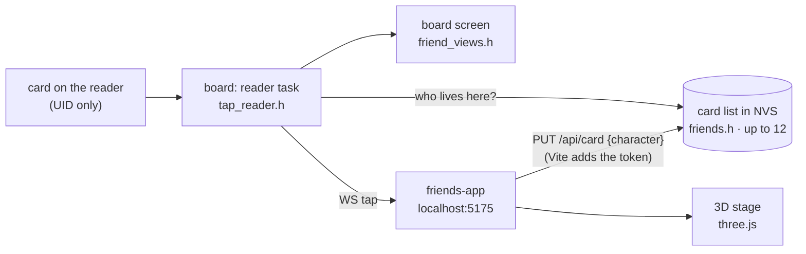

# Card friends (R8)

A kids' app for the `rfid-lab-r8` firmware. Every card is the home of a friend: tap card 1 on the reader and Foxy the fox spins out of it in 3D; tap card 2 and Bolt the robot dances. Friends are moved onto cards by dragging them. The board's own screen shows the friend too.

Two tabs:

- **Play** (for the kids): the 3D stage, your cards, and the shelf of friends to drag onto them.
- **Setup** (for the grown-up): the real board or a pretend one, reader health, every card with its friend and name, sound, calm motion, day or night colours.



## The cast

Eight friends, each with its own colours, sky, move, sparkles and tune. The ids are shared with the firmware (`labs/rfid-lab-r8/src/characters.h`). A test checks the two lists agree.

| Friend        | Move                             | Sparkles      | Sky            |
| ------------- | -------------------------------- | ------------- | -------------- |
| Foxy, fox     | spins twice in a jump            | gold stars    | sunset         |
| Bolt, robot   | dances, arms swinging            | sparks        | deep teal      |
| Ember, dragon | flies a loop, wings flapping     | fire          | volcano orange |
| Pip, penguin  | belly slide in a circle          | snow          | winter blue    |
| Zib, alien    | beams up and spins               | rings         | space purple   |
| Mochi, cat    | happy wiggle                     | hearts        | candy pink     |
| Hopper, frog  | crouches, leaps high with a flip | bubbles       | pond           |
| Luna, unicorn | gallops side to side             | rainbow stars | pastel         |

Tap two cards one after the other and both friends play together on the stage (up to three). A friend nobody tapped for 30 s hops back into its card. Poking a friend on the stage makes it play again.

## Run it

1. Flash the firmware: `cd esp-labs && uv run pio run -d labs/rfid-lab-r8 -e rfid-lab-r8 -t upload` (it uses the Wi-Fi network saved by W1/W2).
2. In the serial monitor type `token` and copy the value (the same token as W2 and R7).
3. Then:

```sh
cd esp-labs/apps/friends-app
cp .env.example .env       # BENCH_URL=http://bench.local (or the board's IP), BENCH_TOKEN=<token>
pnpm install
pnpm dev                   # http://localhost:5175, also on the Mac's IP for a tablet
```

No board at hand? **Setup → Pretend board** plays by the same rules in the browser: tap a card tile to lay it on the pretend reader, **New card** adds one.

## Moving a friend onto a card

Three ways, so it works on a tablet, with a mouse, and with a keyboard:

- drag the friend onto a card (on phones the shelf scrolls sideways; drag a friend up to the cards)
- tap the friend, then tap the card
- Enter on the friend, then Enter on the card (Escape puts it back)

The app sends `PUT /api/card?uid=…` with `{"character": "fox"}`, then `POST /api/show?uid=…`, so the friend pops out on the stage and on the board's screen.

## Checks

```sh
pnpm typecheck
pnpm test        # cast.test.ts: who is on stage, newest first, max 3, follow card changes
                 # characters.test.ts: same cast as the firmware, a move, sparkles and sky each
```
