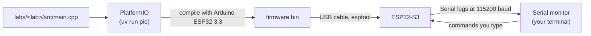
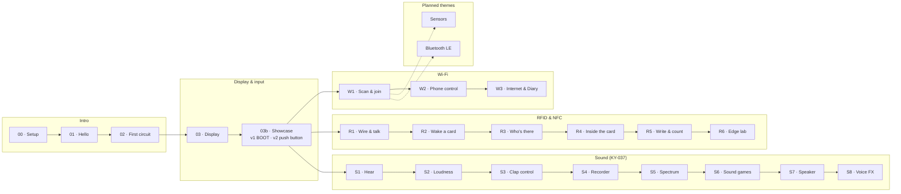
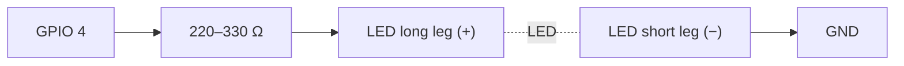
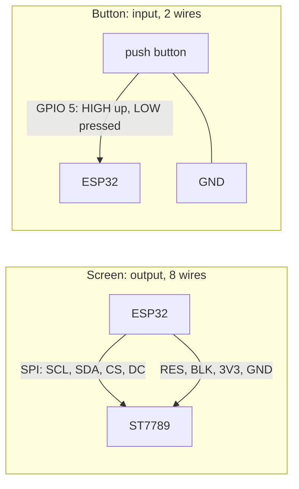
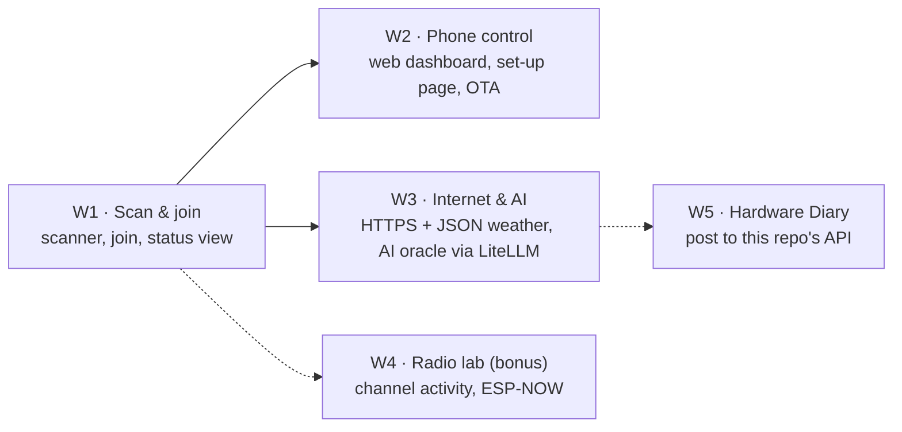
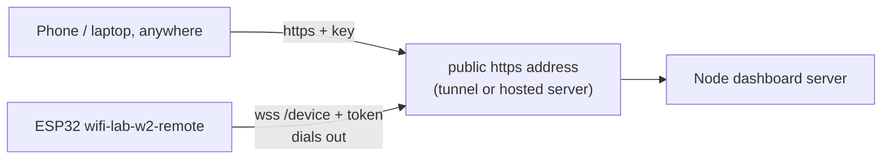
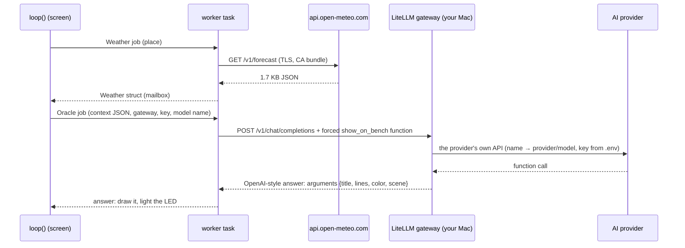
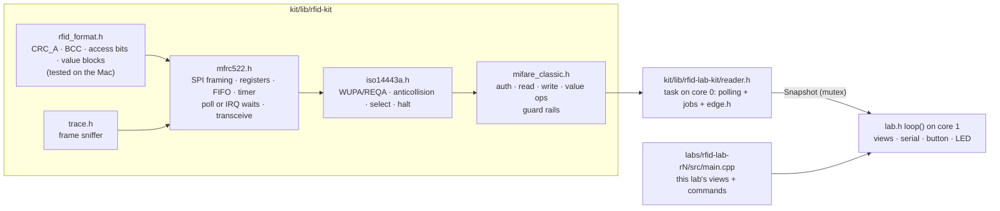
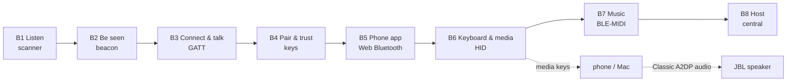
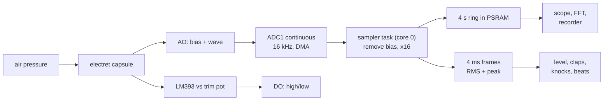

# esp-labs course: ESP32-S3 learning bench

A hands-on, step-by-step exploration of the **ESP32-S3-N16R8**. We work through it together: Claude writes the code, you wire, flash and report what you see.

This is the full course text, moved from `hardware-diary/test-esp` when every lab became its own PlatformIO project under `labs/`. Paths and commands are updated for that layout; run commands from the repo root.

The bench log (`HARDWARE_LOG.md`) and the interactive guide stay in the hardware-diary repo (`test-esp/` and `test-esp-web/`).

## Kit

| Part                        | Notes                                                                                                                                |
| --------------------------- | ------------------------------------------------------------------------------------------------------------------------------------ |
| ESP32-S3-N16R8 DevKitC      | 16 MB flash, 8 MB octal PSRAM, dual-core 240 MHz, Wi-Fi + BLE, on-board RGB LED                                                      |
| 1.9" IPS TFT, 170 × 320     | ST7789 driver, SPI, 8 pins: GND VCC SCL SDA RES DC CS BLK                                                                            |
| RC522 RFID reader           | NXP MFRC522, 13.56 MHz, SPI, **3.3 V only**; comes with a white MIFARE Classic 1K card and a key tag                                 |
| INMP441 microphone          | MEMS microphone with its own amplifier and 24-bit converter, **I2S** digital output; 3.3 V                                           |
| MAX98357A + 3 W 4 Ω speaker | **I2S** class-D amplifier (3 W into 4 Ω at 5 V); the speaker's JST-PH2.0 leads go to the amp's screw terminal                        |
| KY-037 microphone module    | electret capsule + LM393 comparator + trim pot; **AO** (analog) and **DO** (digital). Power it from **3.3 V**, never 5 V             |
| Breadboard, jumper cables   | male-to-male for the breadboard, female-to-male for the display header                                                               |
| LEDs                        | long leg = **+** (anode), short leg = **−** (cathode)                                                                                |
| 220–330 Ω resistor (needed) | Protects the LED and the pin. Not in the kit list yet: most LED kits include some. Lesson 02 lowers the pin's drive as a safety net. |

## Toolchain



- **PlatformIO 6.2.0** (pinned in `pyproject.toml`, installed by `uv`), so nothing global is installed.
- **pioarduino platform 55.03.312-1**, which ships **Arduino-ESP32 3.3.12** (ESP-IDF 5.5.5). Pinned in `common.ini`, which every lab's `platformio.ini` pulls in.
- Board definition `esp32-s3-devkitc1-n16r8`: flash size, PSRAM mode and partition table already match the hardware.

### Commands

Run them from the repo root (`cd esp-labs`). `-d labs/<lab>` picks the lab's project.

```sh
uv sync                                     # once: installs PlatformIO into .venv
uv run pio device list                      # which serial port is the board on?
uv run pio run -d labs/01-hello -e 01-hello -t upload        # compile + flash a lesson
uv run pio device monitor                   # watch the logs (Ctrl+C to quit)
uv run pio run -d labs/01-hello -e 01-hello -t upload -t monitor   # both in one go
ESP_PORT=/dev/cu.usbmodem1101 uv run pio run -d labs/01-hello -e 01-hello -t upload   # force a port
```

## Course map

Lessons are grouped into themes. The guide shows the same themes as its top row; a new theme is one entry in its `TRACKS` list plus `track: "<id>"` on each lesson.



| Theme           | #     | Lesson                | Environment            | Status   | You learn                                                                            |
| --------------- | ----- | --------------------- | ---------------------- | -------- | ------------------------------------------------------------------------------------ |
| Intro           | 00    | Setup                 | none                   | works    | USB ports, drivers, flashing, the serial monitor                                     |
| Intro           | 01    | Hello                 | `01-hello`             | works    | `setup()`/`loop()`, logging, `millis()`, the RGB LED                                 |
| Intro           | 02    | First circuit         | `02-led`               | works    | breadboards, resistors, GPIO, PWM, a state machine                                   |
| Display & input | 03    | Display               | `03-display`           | works    | SPI, RGB565 colours, frame buffers in PSRAM                                          |
| Display & input | 03b   | Showcase, variation 1 | `03b-showcase`         | works    | 3D projection, lookup tables, particles, internal RAM vs PSRAM, timing               |
| Display & input | 03b   | Showcase, variation 2 | `03b-showcase-button`  | on board | inputs vs outputs, pull-ups, interrupts, debouncing, gestures                        |
| Wi-Fi           | W1    | Scan & join           | `wifi-lab-w1`          | built    | station mode, channels, RSSI in dBm, security types, NVS, NTP, mDNS                  |
| Wi-Fi           | W2    | Phone control         | `wifi-lab-w2(-remote)` | on board | REST, WebSocket, captive portal, OTA, relay through a tunnel                         |
| Wi-Fi           | W3    | Internet & AI         | `wifi-lab-w3`          | built    | HTTPS, JSON filters, worker tasks, AI function calling via LiteLLM                   |
| RFID & NFC      | R1–R8 | RFID labs             | `rfid-lab-r1` … `r8`   | R1 works | SPI registers, ISO 14443-A, anticollision, MIFARE memory, value blocks, edge testing |
| Sensors         |       |                       |                        | planned  | I2C sensors (BME280), data over Wi-Fi                                                |
| Bluetooth LE    | B1–B8 | Bluetooth labs        | `ble-lab-b1` … `b8`    | built    | advertising, GATT, pairing & bonds, Web Bluetooth, HID, BLE-MIDI, the central role   |
| Sound           | S1–S8 | Sound labs            | `sound-lab-s1` … `s8`  | built    | ADC/I2S + DMA sampling, decibels & dB SPL, onsets, FFT, WAV, synth, voice effects    |

## Lesson 00: setup

1. Plug the board into the Mac with a **data** USB-C cable (some cables only charge).
2. Use the port labelled **COM** (or **UART**). The serial logs in these lessons go through it. If your board only has one port, tell Claude: the native USB port needs one extra build flag.
3. Run `uv run pio device list`. You should see a new `/dev/cu.usbserial…`, `/dev/cu.usbmodem…` or `/dev/cu.wchusbserial…` entry. This board shows up as `/dev/cu.usbserial-A5069RR4` (FTDI FT232R USB-to-serial chip).
4. If flashing fails with "Failed to connect": hold **BOOT**, tap **RST**, release **BOOT**, and try again.

## Lesson 01: hello

Nothing to wire. Flash `01-hello` and open the monitor. Expected:

- An identity card that reports **16 MB flash** and **~8 MB PSRAM**.
- The on-board RGB LED slowly cycles through a rainbow.
- An `alive for Ns` line every 5 seconds.

No colour? Some boards use GPIO 38 for the RGB LED. Change `PIN_RGB` in `kit/include/pins.h`.

## Lesson 02: first circuit



Type commands into the monitor: `on`, `off`, `blink 200`, `fade`, `sos`, `level 60`, `help`.

## Lesson 03: display

| Display pin | ESP32-S3              | Role                  |
| ----------- | --------------------- | --------------------- |
| GND         | GND (bottom-left pin) | ground                |
| VCC         | 3V3 (top-left pin)    | power (3.3 V)         |
| SCL         | GPIO 12               | SPI clock             |
| SDA         | GPIO 11               | SPI data (MOSI)       |
| RES         | GPIO 8                | reset                 |
| DC          | GPIO 9                | data/command select   |
| CS          | GPIO 10               | chip select           |
| BLK         | GPIO 7                | backlight (HIGH = on) |

The screen shows red/green/blue bars first, then a live sine-wave "bench scope" with uptime and frames per second.

## Lesson 03b: display showcase

Same display wiring as lesson 03. Four scenes: a shaded 3D torus, a per-pixel plasma, fireworks with fading trails, and a live dashboard (chip temperature, RAM, PSRAM, frame times). The frame buffer lives in fast internal RAM when a big enough block is free. The HUD and the serial log show fps, draw ms and send ms. Serial commands in both variations: `next`, `prev`, `scene <1-4>`, `auto on|off`, `hud`, `help`.

|                        | Variation 1                           | Variation 2                                                              |
| ---------------------- | ------------------------------------- | ------------------------------------------------------------------------ |
| Environment            | `03b-showcase`                        | `03b-showcase-button`                                                    |
| Extra wiring           | none                                  | push button: GPIO 5 and GND                                              |
| Controls               | BOOT: click = next, hold = auto-cycle | button or BOOT: click = next, double-click = previous, hold = auto-cycle |
| How the button is read | polled once per frame                 | interrupt on every edge, debounced, bounces counted                      |
| Code                   | `controls/boot_only.cpp`              | `controls/with_button.cpp`                                               |

`main.cpp` only knows actions (next, previous, toggle auto-cycle). `controls.h` is the contract, and each variation's `build_src_filter` compiles exactly one implementation.



**Wiring the push button (variation 2):** put it across the breadboard's centre gap. Wire one leg to the ESP32's **pin 5**, and the **diagonally opposite** leg to any **GND**. This bench uses a screw-terminal expansion board, so both wires end on its sockets labelled 5 and GND; breadboard holes are not connected to the ESP32. (With the board plugged into a breadboard instead, use a free hole in the pin's row.) Pins 4 and 5 sit side by side, so check the label. No resistor: the chip's internal pull-up holds the pin HIGH, and pressing pulls it LOW.

## Wi-Fi track

The ESP32-S3 radio is 2.4 GHz only (802.11 b/g/n): 5 GHz networks never show up. Each lab is **its own firmware with its own command**: `uv run pio run -d labs/wifi-lab-w1 -e wifi-lab-w1 -t upload`, `-e wifi-lab-w2`, and so on. The code they share (scanner, connection, ping, screens) lives in [`kit/lib/wifi-kit`](../kit/lib/wifi-kit/src), so a later lab adds features instead of copying. The saved network is shared too: switching labs keeps it.

Every lab needs the screen from lesson 03. The **push button on pin 5 is optional**: it does exactly what BOOT does, and with nothing wired the chip's internal pull-up keeps the pin quiet.



### Lab W1: Scan & join

`uv run pio run -d labs/wifi-lab-w1 -e wifi-lab-w1 -t upload` · code in [`labs/wifi-lab-w1/src`](../labs/wifi-lab-w1/src/main.cpp). Screen from lesson 03; push button on pin 5 optional (BOOT does the same).

- **Views:** networks (bars, name, channel, lock, dBm) · channels (each network as a hump over the ~4.4 channels its 22 MHz signal covers; 1, 6 and 11 don't overlap) · radar (stronger = closer) · status (clock from internet time, IP, `bench.local`, 60 s signal chart; opens by itself once joined).
- **Joining:** in the serial monitor, `join <#>` with the number from the scan table, then the password on the next line. It is stored in NVS on the chip, never in code, git or the log (only its length is logged). It rejoins after power-off; `forget` erases it.
- **Button or BOOT:** click = next view, double-click = scan now, hold = auto-scan on/off (every 10 s, every 60 s once joined: each scan takes the radio off your router's channel for ~3 s).
- **Serial:** `scan`, `view <1-4>`, `auto on|off`, `join <#>`, `forget`, `reconnect`, `status`, `tz <POSIX TZ>` (default Central European time), `ping` (the router) or `ping <ip>` (e.g. your computer), `help`.
- **Disconnects** are logged with a plain-language reason ("wrong password?", "network not found"); it retries every 30 s.
- The monitor shows your neighbours' network names and what you type, including the password. Keep that out of anything shared; this repo's log records counts only.

### Lab W2: Phone control

`uv run pio run -d labs/wifi-lab-w2 -e wifi-lab-w2 -t upload` · code in [`labs/wifi-lab-w2/src`](../labs/wifi-lab-w2/src/main.cpp). Same wiring as W1. Two variations, like 03b. **Variation 1 · on your Wi-Fi** is everything from W1, plus:

- **`http://bench.local`**: a phone page with status, screen view, brightness, auto-scan, a message for the screen, the LED colour, the networks, live button events and admin actions.
- **REST API** under `/api` (list at `/api`) and a **WebSocket** at `/ws` that pushes status every second, scan results, button presses and update progress.
- **Set-up network:** with no saved Wi-Fi (or after a minute of failed joins) the board also opens `bench-setup`. Its password is shown on the screen only. Join it from a phone and the set-up page opens by itself (captive portal); pick a network and type its password.
- **Firmware updates over HTTP** (`POST /api/ota`): written to the other app slot and verified before the reboot, so a failed upload changes nothing. The screen shows the progress.
- **Admin token:** reboot, forget Wi-Fi and firmware updates need `Authorization: Bearer <token>`. The board creates the token on first boot and keeps it in NVS; serial `token` shows it, `token new` replaces it. Everything else is open on your local network.
- **Serial:** new commands `setup` (open the set-up network), `token`, `token new`.

**Variation 2 · from anywhere** (`uv run pio run -d labs/wifi-lab-w2 -e wifi-lab-w2-remote -t upload`): the same firmware plus a remote link. The board dials **out** to your dashboard server and keeps a secure WebSocket open (`wss://…/device`, signed in with its admin token), so you can drive it from anywhere and nothing opens on your router. The server needs a public https address: your Mac plus a tunnel (`pnpm remote` and `pnpm tunnel:cloudflare` or `pnpm tunnel:ngrok`), or the same app on a hosted server (VPS, Fly.io, Render…). The board only needs the address: serial `relay wss://<host>`, saved on the chip. The dashboard asks for a sign-in key (`DASHBOARD_KEY`) because it is public. A teal ring around the screen's link dot means the server is connected. Firmware updates stay with variation 1 for now. Details: [dashboard/README.md](../apps/dashboard/README.md#remote-control-relay-mode).



**If the page won't open** (what we found on this bench, in order):

1. Type the full address with `http://`: the board has no `https`.
2. Serial `ping` (the router) and `ping <your computer's IP>`. Router answers but your computer doesn't: the router keeps Wi-Fi devices apart. On a FRITZ!Box: WLAN → Sicherheit → tick "WLAN-Geräte dürfen untereinander kommunizieren".
3. Works on the phone but not in the Mac's browser: System Settings → Privacy & Security → Local Network → allow the browser (Chrome and Firefox need it; Safari doesn't).

**Desktop dashboard:** [`dashboard/`](../apps/dashboard/README.md) is a React + Node app (its own pnpm project). The Node server holds the token in `.env`, validates every request, relays the board's live stream and keeps 10 minutes of history; the React app shows live signal and temperature charts and every control above.

```sh
cd esp-labs/apps/dashboard && cp .env.example .env   # ESP_TOKEN = serial command `token`
pnpm install && pnpm dev                         # http://localhost:5173
```

### Lab W3: Internet & AI

`uv run pio run -d labs/wifi-lab-w3 -e wifi-lab-w3 -t upload` · code in [`labs/wifi-lab-w3/src`](../labs/wifi-lab-w3/src/main.cpp). Same wiring; push button optional. Uses the Wi-Fi network W1/W2 saved.

The board becomes an internet client. Every request runs in a worker task (`worker.h`), so the screen keeps animating while it waits, and the footer shows how the last one went (time, size).

- **Weather** from [Open-Meteo](https://open-meteo.com) (no account, no key): `city Hamburg` looks the city up and saves it on the chip; the weather refreshes every 15 minutes. One HTTPS request brings now, the next 24 hours and 7 days in about 1.7 KB of JSON; an ArduinoJson filter keeps only what the screen draws.
- **Views:** now (animated sky, temperature, feels-like, wind, humidity) · forecast (temperature line, and rain chance bars on their own scale) · week (each day's low-to-high range on one shared scale) · oracle · status.
- **The Bench Oracle:** the board sends an AI model what it knows about the moment as JSON: place, time, weather, its own temperature and signal. The request offers one function, `show_on_bench {title, lines, color, scene}`, and forces the model to call it, so the answer is always JSON the board can draw: a haiku (double-click in the oracle view, or hold the button anywhere) or an answer (`ask should I bike to work?`). The LED takes the colour the model picked; time and tokens show under the answer.
- **Any provider, through LiteLLM:** the board speaks one OpenAI-style API to the [AI gateway](../apps/ai-gateway/README.md) on your Mac (`ai url http://<Mac IP>:4000`, `ai key <LITELLM_MASTER_KEY>`). `ai-gateway/config.yaml` maps names to models: `oracle` (Claude Opus), `oracle-fast` (Claude Haiku), and whatever you add (OpenAI, Gemini, a local Ollama model). `ai model <name>` switches without reflashing. Provider keys stay in the gateway's `.env`; the board stores only the gateway key (NVS, never logged, last 4 characters shown; `ai key forget` erases it). At most one question per 10 s, and never on its own.
- **Serial:** `city <name>`, `weather`, `oracle`, `ask <question>`, `ai`, `ai url <url>`, `ai key <key>`, `ai key forget`, `ai model <name>`, `led off`, `view <1-5>`, `status`, `ping [ip]`, `tz <TZ>`, `reconnect`, `forget`, `help`.



## RFID track

Each lab is its own firmware with its own command, like the Wi-Fi labs:

| Lab                | Command                                   | Views              | Adds these serial commands                                                               |
| ------------------ | ----------------------------------------- | ------------------ | ---------------------------------------------------------------------------------------- |
| R1 Wire & talk     | `uv run pio run -d labs/rfid-lab-r1 -e rfid-lab-r1 -t upload` | chip · card        | `chip` `reset` `selftest` `loopback` `regs` `spi` `gain` `timeout` `irq`                 |
| R2 Wake a card     | `uv run pio run -d labs/rfid-lab-r2 -e rfid-lab-r2 -t upload` | + trace            | `poll` `trace`                                                                           |
| R3 Who's there     | `uv run pio run -d labs/rfid-lab-r3 -e rfid-lab-r3 -t upload` | (same)             | `inventory`                                                                              |
| R4 Inside the card | `uv run pio run -d labs/rfid-lab-r4 -e rfid-lab-r4 -t upload` | + memory           | `dump` `read`                                                                            |
| R5 Write & count   | `uv run pio run -d labs/rfid-lab-r5 -e rfid-lab-r5 -t upload` | + credits          | `write` `credits`                                                                        |
| R6 Edge lab        | `uv run pio run -d labs/rfid-lab-r6 -e rfid-lab-r6 -t upload` | + edge             | `edge`                                                                                   |
| R7 Card manager    | `uv run pio run -d labs/rfid-lab-r7 -e rfid-lab-r7 -t upload` | door · cards · log | a bench door managed from the React app in [`door-app`](../apps/door-app/README.md) over Wi-Fi   |
| R8 Card friends    | `uv run pio run -d labs/rfid-lab-r8 -e rfid-lab-r8 -t upload` | stage · cards      | a kids' lab: each card's friend pops out in 3D in [`friends-app`](../apps/friends-app/README.md) |

Each [`labs/rfid-lab-rN/src/main.cpp`](../labs/rfid-lab-r1/src/main.cpp) is a short list: that lab's views (with what a double-click does on each) and its commands, so `help` shows exactly what the lesson teaches. The shared code is in [`kit/lib/rfid-lab-kit`](../kit/lib/rfid-lab-kit/src): the reader task, the six screen views, the edge experiments, every command (`lab_commands.h`) and the lab shell (`lab.h`: screen, button, LED, serial). No RFID library: [`kit/lib/rfid-kit`](../kit/lib/rfid-kit/src) is our own driver, written in layers so every byte stays visible. The reader runs in its own task on core 0 and owns the chip; `loop()` on core 1 only draws and parses commands.



**Wiring** (the screen stays as in lesson 03; the RC522 is on the S3's second SPI bus, SPI3, so it never shares with the screen):

| RC522 pin | ESP32-S3         | Role                                                                           |
| --------- | ---------------- | ------------------------------------------------------------------------------ |
| SDA       | GPIO 15          | chip select (NSS) in SPI mode, not I2C data                                    |
| SCK       | GPIO 16          | SPI clock                                                                      |
| MOSI      | GPIO 17          | ESP32 → chip                                                                   |
| MISO      | GPIO 18          | chip → ESP32                                                                   |
| IRQ       | GPIO 13          | optional; without it the firmware polls                                        |
| GND       | GND              | right header, top pin                                                          |
| RST       | GPIO 14          | reset; low = hard power-down                                                   |
| 3.3V      | 3V3 (second pin) | **never 5 V**: the MFRC522 is rated 2.5–3.6 V and its pins aren't 5 V tolerant |

**Views** (click to cycle, double-click runs the view's action, hold pauses polling): chip · card · trace · memory · credits · edge.

**On-board RGB LED:** a bright green flash every time a card is read (a new card, or a command reaching it) · steady green while a card is on the reader · red when the reader chip stops answering · off with no card.

| Step               | Serial commands                                                                                           | What you learn                                                                                                                                                                                                         |
| ------------------ | --------------------------------------------------------------------------------------------------------- | ---------------------------------------------------------------------------------------------------------------------------------------------------------------------------------------------------------------------- |
| R1 Wire & talk     | `chip`, `reset`, `selftest`, `loopback`, `regs`, `spi <MHz>`, `gain <0-7>`, `irq on\|off`, `timeout <us>` | the SPI address byte, registers, the FIFO, the datasheet self-test (64 bytes, section 16.1.1; clones such as the FM17522 run it twice and compare), what 00h / FFh mean, a 2 s watchdog that hard-resets a silent chip |
| R2 Wake a card     | `poll on\|off`, `trace on\|off`                                                                           | the 13.56 MHz field, 100 % ASK, load modulation, WUPA/ATQA, a polling task, sniffing frames                                                                                                                            |
| R3 Who's there     | `inventory` (card and tag together)                                                                       | bit collisions, the anticollision tree walk, NVB, BCC, cascade levels, SAK, HALT/WUPA                                                                                                                                  |
| R4 Inside the card | `dump`, `read <block>`                                                                                    | sectors, trailers, access bits (stored twice), 3-pass authentication inside the chip, encrypted frames                                                                                                                 |
| R5 Write & count   | `write <block> <text>`, `credits`, `credits init\|add\|use <n>`                                           | block writes with ACK/NAK, read-back checks, value blocks, INCREMENT/DECREMENT/TRANSFER, a backup block                                                                                                                |
| R6 Edge lab        | `edge spi`, `edge gain`, `edge timeout`, `edge timing`, `edge irq`, `edge crc`, `edge stress [n]`         | each setting pushed until it breaks: SPI clock vs the 10 MHz spec, gain vs distance, the card's ~86 µs reply time, per-step timing, IRQ vs polling, offloading the CRC, read reliability                               |

**R7 · Card manager** (`labs/rfid-lab-r7/src`, app in [`door-app`](../apps/door-app/README.md)): the board keeps a list of up to 20 cards in NVS (name, role, blocked, end date, hours, uses left) and decides every tap itself; the card only brings its UID. A JSON API and a WebSocket on port 80 (the same web libraries as W2) let the React app add cards (tap within 20 s), edit and block them, copy one card's rules to another, replace a lost card (the new one takes over its rules, the old one is blocked), write a name label, wipe the lab data blocks, open a lock remotely and switch on lockdown, with a live access log. Two simulated locks: the front door (every role) and the admin room (admin cards only); the one reader is mounted at one of them at a time (app or serial `at front|admin`). Card data: save a card's lab blocks (4-6, 8-10) as a snapshot on the board (`snapshots.h`, up to 8 in NVS), write it back, copy a card onto another (two taps), compare a snapshot with the card on the reader, download and import snapshots as JSON files. A copy never moves block 0 or the trailers, so it stays a different card to the door. Every change needs the admin token (shared with W2, now in `kit/lib/wifi-kit/src/api_token.h`); the app's Vite proxy adds it from `.env`, so the browser never holds it. Rule order in `access_rules.h`, checked on the Mac by `labs/rfid-lab-r7/test/host/door_rules_test.cpp`.

**R8 · Card friends** (`labs/rfid-lab-r8/src`, app in [`friends-app`](../apps/friends-app/README.md)): a playful lab for kids, built from R7's parts (driver, reader health checks, web libraries, admin token). Every card is the home of a friend: a fox, a robot, a dragon, a penguin, an alien, a cat, a frog or a unicorn. A card the board hasn't seen adds itself on its first tap (up to 12, in NVS namespace `friends`, separate from R7's list); the board stores only which friend lives on it and its name, and reads nothing but the UID. Tap a card: the friend pops out on the board's screen with stars (`friend_views.h`, drawn from circles and triangles in `characters.h`), the LED flashes in its colour, and the app's 3D stage (three.js, toon shading, no model files) plays its own move, sparkles, sky and tune. Card 1 and card 2 show different friends, and two cards tapped one after the other play together. The app has two tabs: **Play** (stage, cards, a shelf of friends to drag onto cards, also by tap-then-tap or keyboard) and **Setup** (real or pretend board, reader health, the card list, sound, calm motion, day/night). Serial: `cards`, `cast`, `give <n> <friend>`, `name <n> <name>`, `forget <n>`.

**Guard rails:** the firmware only uses the factory key on your own cards; it never writes block 0 or a sector trailer (a trailer with broken access bits locks its sector for good), and it checks a block's access bits before writing. The key never goes into the trace.

**Host test** (no board): `c++ -std=c++17 -Wall -I kit/lib/rfid-kit/src kit/test/host/rfid_format_test.cpp -o /tmp/rfid_test && /tmp/rfid_test` checks CRC_A against frames every sniffer shows (`50 00 → 57 CD`, `30 00 → 02 A8`), access bits and value blocks.

The guide has the interactive side: a 3D model of the field and the card (with a range chart), a 3D memory map you open sector by sector, bit-level SPI and anticollision walk-throughs, access-bit and value-block decoders, step-by-step frame diagrams, and edge charts that plot the tables you paste from the monitor.

## Bluetooth LE track

The ESP32-S3 has **Bluetooth LE 5 only**. There's no Classic Bluetooth, so it can't stream audio to a speaker or headphones (A2DP), and Classic-only keyboards are invisible to it. The labs go from listening to pairing to controlling, and end with the board hosting your own keyboard. Each lab is its own firmware with its own command. They share `kit/lib/ble-kit` (NimBLE-Arduino 2.5.1):

- the lab shell, with a status bar on every view: radio glyph, encryption lock, bond key, signal bars
- the link state and activity log, written from NimBLE's task and drawn by `loop()`
- the advertising decoder (`ad_format.h`) and the scan table
- the Bench GATT service and the shared touch-pad helper
- the BLE-MIDI codec and the HID Report Map parser

Wiring is the screen from lesson 03; the push button on GPIO 5 stays optional.

| Lab                 | Command                                  | Views                                                       | The board is          |
| ------------------- | ---------------------------------------- | ----------------------------------------------------------- | --------------------- |
| B1 Listen           | `uv run pio run -d labs/ble-lab-b1 -e ble-lab-b1 -t upload` | radar · list · inspect · air                                | scanner               |
| B2 Be seen          | `uv run pio run -d labs/ble-lab-b2 -e ble-lab-b2 -t upload` | packet · air · budget · log                                 | broadcaster (beacon)  |
| B3 Connect & talk   | `uv run pio run -d labs/ble-lab-b3 -e ble-lab-b3 -t upload` | gatt · message · link · log                                 | GATT server           |
| B4 Pair & trust     | `uv run pio run -d labs/ble-lab-b4 -e ble-lab-b4 -t upload` | ceremony · bonds · gatt · link · log                        | GATT server with keys |
| B5 Phone app        | `uv run pio run -d labs/ble-lab-b5 -e ble-lab-b5 -t upload` | sketch · live · speed · gatt · link · log                   | server for `ble-app`  |
| B6 Keyboard & media | `uv run pio run -d labs/ble-lab-b6 -e ble-lab-b6 -t upload` | media · slides · typer · keys · link · log                  | BLE keyboard          |
| B7 Music            | `uv run pio run -d labs/ble-lab-b7 -e ble-lab-b7 -t upload` | keys · sequencer · roll · link · log                        | BLE-MIDI instrument   |
| B8 Host             | `uv run pio run -d labs/ble-lab-b8 -e ble-lab-b8 -t upload` | devices · explore · keyboard · mouse · reports · link · log | central (HID host)    |



Phone apps: nRF Connect for Mobile (Nordic) or LightBlue for B1-B4; the `ble-app` for B5 and B7 (Chrome on Mac or Android, Bluefy on iPhone); GarageBand for B7.

**B1 · Listen** (`uv run pio run -d labs/ble-lab-b1 -e ble-lab-b1 -t upload`, `labs/ble-lab-b1/src`): a continuous scan. NimBLE keeps nothing; `scan_table.h` keeps up to 48 devices with a smoothed RSSI, their advertisement and their scan response. Four views:

- **radar:** distance from RSSI on a log scale; the colour is a guess at the kind, from appearance, maker data and services
- **list:** the strongest devices
- **inspect:** 31 cells per packet, coloured by AD structure and decoded
- **air:** packets per second for a minute, and address types

Commands: `scan`, `mode active|passive`, `timing <interval> <window>`, `near <dBm>`, `list`, `pick`, `next`, `bytes`, `watch` (one line per packet, which shows the advertising interval), `calib` (1 m reference), `clear`. The decoder is checked on the Mac by `kit/test/host/ble_ad_test.cpp`. Everything you hear belongs to someone: keep neighbours' addresses out of logs.

**B2 · Be seen** (`uv run pio run -d labs/ble-lab-b2 -e ble-lab-b2 -t upload`, `labs/ble-lab-b2/src`): the board turns broadcaster. In `bench` mode its advertisement carries live values as manufacturer data under the SIG's test company ID 0xFFFF (version, button presses, chip temperature in °C × 100, uptime), refreshed every second, so a phone reads them without connecting. `mode ibeacon` (Apple 4C 00 02 15, UUID = the Bench service, big-endian major/minor, −59 dBm at 1 m), `mode url` (Eddystone-URL in service data FEAA) and `mode name` fill the same 31 bytes differently; what doesn't fit goes to the scan response. `connectable` and `scanresp` switch between ADV_IND, ADV_SCAN_IND and ADV_NONCONN_IND (non-connectable keeps the old 100 ms floor). Views: packet (31 cells per packet, changed bytes flash), air (channel 37/38/39 hops with the random advDelay, drawn from the settings), budget (an estimate for a coin-cell beacon chip, not this board), log. The packets are built in `beacon_payload.h`, checked on the Mac by `labs/ble-lab-b2/test/host/ble_beacon_test.cpp`. iPhone apps can't see iBeacon frames (iOS filters them): test that mode on Android.

- Watch the uptime bytes change in nRF Connect without connecting; double-click and see the press counter follow.
- `connectable off`, `scanresp off`: the Connect button disappears on the phone.
- `interval 1000` and `power -12`, then the budget view.

**B3 · Connect & talk** (`uv run pio run -d labs/ble-lab-b3 -e ble-lab-b3 -t upload`, `labs/ble-lab-b3/src`): the Bench service from `kit/lib/ble-kit/src/bench_service.h`, plus the standard Device Information and Battery services:

- LED `0001`: read/write, 3 bytes
- Message `0002`: text
- Button `0003`: notify
- Temperature `0004`: notify, with a 2904 format descriptor
- Uptime `0005`

The phone connects from nRF Connect or LightBlue. Every operation lights its row on the gatt view and shows up in the activity log. Commands: `adv`, `message`, `press`, `params fast|slow`, `phy 1m|2m`, `disconnect`, `led auto`.

**B4 · Pair & trust** (`uv run pio run -d labs/ble-lab-b4 -e ble-lab-b4 -t upload`, `labs/ble-lab-b4/src`): B3's Bench service plus a **Vault** characteristic that needs an encrypted, authenticated (MITM-protected) link. Reading it from the phone starts pairing with LE Secure Connections; `pair passkey|compare|justworks` sets the board's IO capabilities (DisplayOnly, DisplayYesNo, NoInputNoOutput) and is saved in NVS (namespace `b4`). The passkey is drawn over any view; for numeric comparison a click says yes and a long press no (or serial `yes`/`no`). Bonds (LTK + IRK) are stored by NimBLE; `bonds`, `forget <n>|all`, `allow bonded|anyone` (filter accept list with the bonded identities; the controller resolves private addresses with the stored IRKs), `lock on|off` (LED and Message need encryption too; the GATT table is built at start-up, so it saves and restarts), `secure` (Security Request). Views: ceremony (eight phases, inferred ones drawn as rings, failures in coral with the SMP/HCI reason), bonds (identity addresses + an animation of the IRK resolving changing private addresses), gatt, link, log. After `forget` on the board, forget "Bench B4" on the phone too, or the next connection fails with "key missing".

- `pair passkey`, read the Vault, type the TFT's six digits: the secret appears.
- `pair justworks` (forget on both sides first): encrypted, yet the Vault is refused. Why?
- `allow bonded`: only your phone gets in.

**B5 · Phone app** (`uv run pio run -d labs/ble-lab-b5 -e ble-lab-b5 -t upload`, app in [`ble-app`](../apps/ble-app/README.md)): B3's Bench service plus four characteristics of its own (`labs/ble-lab-b5/src/extras.h`): **Canvas** `ba5e0010` (writes without response in a small binary drawing protocol: clear, stroke, rect, text, dot on a 320 × 128 area, documented in `canvas_protocol.h` and checked on the Mac by `labs/ble-lab-b5/test/host/b5_canvas_test.cpp`), **Sensors** `ba5e0011` (12 bytes every 200 ms: temperature, touch on GPIO 1, free heap, link RSSI, sequence), **Speed** `ba5e0012` (notifies N bytes in MTU − 3 packets from its own FreeRTOS task, retrying when the stack's buffers are full, then a summary) and **Link** `ba5e0013` (asks for a fast or slow interval, the 2M PHY or 251-byte radio packets). The NimBLE task only queues; loop() draws the sketch into its own frame buffer. Views: sketch, live, speed, gatt, link, log. The app is `esp-labs/apps/ble-app`, a static React + Vite app (own pnpm project, door-app's exact versions, no server) that talks to the board with **Web Bluetooth**: Connect (chooser, GATT explorer, byte log), Control (colour wheel, message, button feed, temperature), Sketch, Live, Speed and Music (BLE-MIDI piano + WebAudio synth for B7). It runs at `http://localhost:5177` in Chrome/Edge on the Mac; phones need https, so `pnpm tunnel` (cloudflared) and Chrome on Android or the Bluefy browser on iPhone (Safari and Firefox have no Web Bluetooth). Optional hardware: one jumper wire on GPIO 1 as a touch sensor.

- Draw in the Sketch tab and watch the strokes land on the board.
- Touch the GPIO 1 wire with the Live tab open.
- Run 50 kB in Speed, then Fast interval + 2M PHY + Long packets and run again: compare Mac vs phone.

**B6 · Keyboard & media** (`uv run pio run -d labs/ble-lab-b6 -e ble-lab-b6 -t upload`, `labs/ble-lab-b6/src`): the board is a Bluetooth LE keyboard with media keys (HID over GATT, NimBLE's `NimBLEHIDDevice`). `hid_keyboard.h` holds the Report Map, commented byte by byte: report 1 = keyboard (modifier bits, a reserved byte, six key numbers, plus an output report for the computer's Caps/Num Lock lights), report 2 = consumer control (play/pause CD, next B5, previous B6, volume E9/EA, mute E2). Pairing is Just Works + Secure Connections with bonding, because HID hosts only read input reports over an encrypted link. The media and slides views are modes where the button is the remote (click / double-click / hold, hold 2 s = next view); two optional touch wires on GPIO 1/2 are volume down/up (`touch on`, `touch_pads.h`). `type` and `key` go through `keymap.h`: a keyboard sends key numbers, never letters, and the computer applies its own layout, so `layout de` makes the board pick German keys (y/z swap, moved punctuation; AltGr/Option characters are skipped). Checked on the Mac by `labs/ble-lab-b6/test/host/ble_keymap_test.cpp`. The ESP32-S3 has no Classic Bluetooth, so it can't stream audio to a speaker: it controls the phone, and the phone plays to the speaker (your JBL included).

- Pair "Bench B6" in your phone's or Mac's Bluetooth settings, play music, click = play/pause, double-click = next track.
- `touch on`, then touch the GPIO 2 wire: volume up.
- `layout de` (or `us`), then `type yes, this is the bench` into Notes.
- `key cmd+space` (Spotlight), `snippet <text>` + double-click on the typer view.
- Hold 2 s to the slides view and click through a presentation. `forget` unpairs (forget it on the phone too).

Host test (no board): `c++ -std=c++17 -Wall -I labs/ble-lab-b6/src labs/ble-lab-b6/test/host/ble_keymap_test.cpp -o /tmp/ble_keymap_test && /tmp/ble_keymap_test`.

**B7 · Music** (`uv run pio run -d labs/ble-lab-b7 -e ble-lab-b7 -t upload`, `labs/ble-lab-b7/src`): the board is a Bluetooth MIDI instrument with the standard BLE-MIDI service (`03B80E5A-…`, one characteristic `7772E5DB-…`: read, write without response, notify), so GarageBand (Mac via Audio MIDI Setup → MIDI Studio → Bluetooth, or iPhone/iPad → Advanced → Bluetooth MIDI Devices), Android BLE-MIDI apps and the ble-app Music tab treat it as a MIDI keyboard. The packet format (header + 13-bit millisecond timestamps, running status, SysEx skipped across packets) lives in `kit/lib/ble-kit/src/midi_ble.h`, checked by `kit/test/host/ble_midi_test.cpp`. `music.h` has scales, three public-domain tunes, a 16-step drum machine on channel 10 and a scheduler that sends whatever is due in one packet. Inputs: the button (click = next note, double-click = chord, hold = all notes off, hold 2 s = next view), five optional touch wires on GPIO 1, 2, 6, 13, 14 (13/14 belong to the RC522 when it's wired), and serial commands. Notes from the synth side light the piano strip in blue and the on-board LED in the note's colour. On connect the board asks for a 7.5-15 ms interval; the link view shows why every note waits up to one interval and how timestamps keep the rhythm. MIDI is notes, not audio: the synth makes the sound, and can play it on your JBL.

- Connect from GarageBand / Audio MIDI Setup / the ble-app Music tab; click the button.
- `tune twinkle`, `tune ode`, `tune frere`; `play C4 E4 G4 C5`, chords `C4+E4+G4`.
- `beat house` + `seq on`, `bpm 120`; `scale blues`, `octave 3`.
- `touch on` with five jumper wires, then play them.

Host test (no board): `c++ -std=c++17 -Wall -I kit/lib/ble-kit/src kit/test/host/ble_midi_test.cpp -o /tmp/ble_midi_test && /tmp/ble_midi_test`.

**B8 · Host** (`uv run pio run -d labs/ble-lab-b8 -e ble-lab-b8 -t upload`, `labs/ble-lab-b8/src`): the roles swap and the board becomes the central, the way a laptop is. It scans for connectable devices (B1's `scan_table.h`; keyboards and mice marked HID, bonded ones with a key), connects (`connect <n>`), and explores the device's GATT tree. Explore is read-only and only reads the public basics: name, appearance, maker, model, firmware, battery and PnP ID. It never touches vendor characteristics, which is why your JBL shows just "the JBL app's own service". The audio goes over Classic Bluetooth, which the S3 doesn't have. `host` pairs as the central with bond, MITM and Secure Connections, using display-only IO: a keyboard gets passkey entry (the board shows 6 digits, you type them on the keyboard plus Enter), and a mouse falls back to Just Works. It then reads the Report Map (2A4B) and parses it with `kit/lib/ble-kit/src/hid_report.h`: items, usage pages, report IDs, bit offsets, and the keyboard and mouse layouts. Each input Report is matched to its ID through descriptor 2908 and subscribed to (CCCD 01 00). Key codes become text on the TFT with `layout us|de` (CP437 font, so ä ö ü ß show). The mouse is a paint toy: left button draws, right changes colour, middle clears, the wheel sets the brush. `boot on` switches to the fixed boot-protocol formats. Connecting, discovery and pairing run in their own FreeRTOS task, so the screen and the passkey overlay never freeze. A bonded keyboard that advertises again (by public or static address) is reconnected and hosted by itself. Gotchas: many keyboards only advertise in pairing mode, and one paired to the Mac must be moved to another channel or unpaired there first. Apple Magic Keyboards are Classic Bluetooth and never show up. After `forget`, remove the board on the keyboard side too. Host test: `c++ -std=c++17 -Wall -I kit/lib/ble-kit/src kit/test/host/ble_hid_test.cpp -o /tmp/ble_hid_test && /tmp/ble_hid_test` (boot keyboard, 12-bit mouse with report IDs, keyboard + media keys, US/DE).

What to try: `list` → `connect 1` → long press (host) and type the passkey · type, hold Shift, `layout de` · the reports view, then `boot on` + `host` · pair your mouse and paint · power-cycle the board and watch it reconnect · `connect <n>` on the JBL.

Host tests (no board), from the repo root:

```sh
./tools/host-tests.sh   # every host test, kit and labs
```

## Sound track

Three sound parts, all optional except one microphone:

- **KY-037** (analog): an electret capsule, an **LM393 comparator** and a blue trim pot. **AO** is the microphone's voltage, a small wave on a steady bias, measured by the ESP32's ADC. **DO** is the comparator's yes/no against the pot. No amplifier: a good _loudness_ sensor; voices across the room sit close to the hiss.
- **INMP441** (digital): a MEMS microphone with its own amplifier and 24-bit converter, sending numbers over **I2S**. Far cleaner, and its sensitivity is specified (−26 dBFS at 94 dB SPL), so the labs can show **real dB SPL**.
- **MAX98357A + speaker**: an I2S class-D amplifier. The board sends 16-bit samples, the amp drives the speaker. Every lab can beep and chime; S4 plays clips back, S7 is a synth, S8 changes your voice.

Every lab picks the microphone at start-up: `mic auto` (default) uses the INMP441 when it answers on the I2S pins, the KY-037 otherwise; `mic ky037` / `mic inmp441` force one (saved, then a restart). The speaker is always driven; with nothing wired it is simply silent. An **echo guard** keeps the board's own sounds out of the clap, knock and voice detectors.

| Module pin | ESP32-S3 | Why this pin                                                                 |
| ---------- | -------- | ---------------------------------------------------------------------------- |
| +          | 3V3      | **never 5 V**: AO and DO swing up to the supply, and the pins take 3.3 V max |
| G          | GND      |                                                                              |
| AO         | GPIO 6   | must be an **ADC1** pin (GPIO 1–10): ADC2 is busy while Wi-Fi is on          |
| DO         | GPIO 21  | any digital pin                                                              |

| INMP441 pin | ESP32-S3 |     | MAX98357A pin | ESP32-S3                     |
| ----------- | -------- | --- | ------------- | ---------------------------- |
| VDD         | 3V3      |     | VIN           | 5V (louder) or 3V3           |
| GND         | GND      |     | GND           | GND                          |
| L/R         | GND      |     | BCLK          | GPIO 39                      |
| SCK         | GPIO 40  |     | LRC           | GPIO 38                      |
| WS          | GPIO 41  |     | DIN           | GPIO 47                      |
| SD          | GPIO 42  |     | GAIN, SD      | unconnected (9 dB, mono mix) |

The microphone uses the S3's I2S0 peripheral and the amplifier I2S1, so both run at once. Start with `vol 20`: a 3 W speaker next to the microphone is loud.

The screen from lesson 03 stays as it is; the push button on GPIO 5 and lesson 02's LED on GPIO 4 are optional (S2, S3 and S6 use the LED as a light).

Each lab is its own firmware with its own command. They share [`kit/lib/sound-kit`](../kit/lib/sound-kit/src):

- `mic.h`: the sampler. The ADC runs in **continuous mode**: its own timer starts 16 000 conversions a second and the **DMA** moves them into RAM. A task on core 0 removes the bias, keeps the last 4 s in a ring in PSRAM (each sample has a running number), and hands 4 ms "frames" (RMS + peak) to `loop()`.
- `level.h`: decibels, fast (125 ms) and slow (1 s) like a real meter, and the **noise floor** that follows your room's quiet. Most numbers are "dB above the quiet".
- `onsets.h` (claps vs voices, grouping), `rhythm.h` (knock patterns, beats), `spectrum.h` (our own FFT, notes), `trigger.h` (the voice-activated recorder), `wav.h`.
- `sound_lab.h` + `sound_views.h`: the lab shell. Every lab's header shows the **ear**: a level bar, the DO lamp and a red **REC** dot whenever anything records. Shared commands: `quiet` (re-learn the quiet), `plot`, `status`, `rate <Hz>`, `atten <0|2.5|6|12>`, `view <n>`, `help`.



| Lab             | Command                                    | Views                               | You learn                                                              |
| --------------- | ------------------------------------------ | ----------------------------------- | ---------------------------------------------------------------------- |
| S1 Hear         | `uv run pio run -d labs/sound-lab-s1 -e sound-lab-s1 -t upload` | scope · bias · comparator · numbers | ADC + DMA, bias and attenuation, mV per step, tuning the pot           |
| S2 Loudness     | `uv run pio run -d labs/sound-lab-s2 -e sound-lab-s2 -t upload` | meter · minute · diary · alarm      | decibels, fast/slow smoothing, noise floor, hysteresis                 |
| S3 Clap control | `uv run pio run -d labs/sound-lab-s3 -e sound-lab-s3 -t upload` | timeline · lamp · patterns · tune   | onset detection, clap vs voice by shape, patterns, calibration         |
| S4 Recorder     | `uv run pio run -d labs/sound-lab-s4 -e sound-lab-s4 -t upload` | recorder · clips · web              | pre-roll, triggers, WAV, streaming, a guarded networked mic            |
| S5 Spectrum     | `uv run pio run -d labs/sound-lab-s5 -e sound-lab-s5 -t upload` | bars · waterfall · tuner · steer    | FFT, windows, Nyquist, notes and cents, control by pitch               |
| S6 Sound games  | `uv run pio run -d labs/sound-lab-s6 -e sound-lab-s6 -t upload` | knock · bird · party                | tempo-free rhythm match, game physics, latency, beat detection         |
| S7 Speaker      | `uv run pio run -d labs/sound-lab-s7 -e sound-lab-s7 -t upload` | wave · keys · envelope · tunes · fx | I2S out, class D, timbre and harmonics, ADSR, chords, procedural sound |
| S8 Voice FX     | `uv run pio run -d labs/sound-lab-s8 -e sound-lab-s8 -t upload` | parrot · echo · robot · scope       | resampling, ring modulation, delay + feedback, howl, latency           |

**S1 · Hear:** the raw signal. **scope** (a triggered oscilloscope: mV with the KY-037, % of full scale with the INMP441; double-click freezes), **mics** (both microphones at once, stacked, each with its own quiet: how many dB more clearly the INMP441 hears the same clap; with one mic it shows how to wire the other), **bias** (KY-037: a 0–3.3 V ruler with the bias, the swing, the ADC's range, clipping and "try atten 6" hints, double-click steps the attenuation; INMP441: a 24-bit ladder, bits in use and headroom), **comparator** (KY-037: DO's lamp and a 6 s strip of loudness above DO, with pot advice; INMP441: the same in software, `thresh <dB>`), **numbers** (source, measured rate, lost samples, dBFS, floor, dB SPL). Serial: `freeze`, `span <ms>`, `trigger`, `thresh <dB>`, `pot`, `dump [n]`.

**S2 · Loudness:** a sound level meter. With the INMP441 it shows **real dB SPL** (unweighted, about ±2 dB) on a 30–110 scale with whisper, talk, the 85 dB hearing-risk line and loud; with the KY-037, dB above the quiet. **meter**, **minute** (the loudest of every ¼ s), **diary** (10 minutes as 10 s candles), **alarm** (over the limit for `hold` ms: the screen pulses, the LED on GPIO 4 lights and the speaker plays the alarm tune once; any button silences it). Serial: `units spl|quiet`, `speed fast|slow`, `limit <dB> [spl|quiet]` (80 dB SPL or 35 above quiet), `hold <ms>`, `alarm on|off`, `alarm sound on|off`, `diary`. Settings in NVS (`loud`).

**S3 · Clap control:** a clap is a _shape_, not just loudness: a jump of 18 dB and quiet again within 160 ms. Longer sounds (a word, a whistle) are shown as "long" and ignored. Claps close together form a group; a 650 ms pause ends it. Defaults: **1 clap = LED on GPIO 4, 2 = next RGB colour, 3 = screen sleep, 4 = party**. Serial: `map <1-4> <led|colour|dark|screen|view|party|tune|none>`, `maps`, `sens <dB>`, `gap <ms>`, `learn` (clap 5 times: the sensitivity becomes 60 % of your softest), `test` (every event on serial), `do <action>`, `sound on|off`. Every action answers with its own little sound (an unknown pattern buzzes); the echo guard keeps the board from clapping for itself. Mappings in NVS (`claps`).

**S4 · Recorder:** a voice-activated recorder into PSRAM: up to 12 clips, 6 MB, **lost on reset**. `arm` listens; a sound 15 dB above the quiet starts a clip **half a second earlier** (the ring already holds it), and 1.2 s of quiet ends it; bangs shorter than 0.4 s are dropped. `rec`/`stop` record by hand (long press toggles). With the INMP441 the clips are pleasant to listen to; with the KY-037 they are hissy. Listen and download:

- **Board:** `play [n] [speed]` on the speaker (0.5 = a giant, 2 = a chipmunk); on the clips view double-click plays the picked clip, long press picks the next. While it plays, the voice trigger is paused.

- **Phone:** with the Wi-Fi network W1 saved, open `http://bench.local`, paste the admin token from serial `token` (the same token as W2/R7/R8, kept in the page's sessionStorage only): live meter, arm/record/stop, every clip as a waveform you can play, download and delete. Every audio route needs the token.
- **USB:** close the serial monitor, then `uv run python tools/sound_pull.py /dev/cu.usbserial-A5069RR4 <n> [clip.wav]` (base64 over serial with a CRC-32 check).

Clips are normalised (up to ×64) when sent, so the hiss gets louder with the voice. Whoever starts a recording, the board always shows **REC** on its screen and a red RGB LED. Serial: `arm`, `rec`, `stop`, `trigger <dB>`, `hold <ms>`, `max <s>`, `clips`, `next`, `del <n>`, `clear`, `send <n>`, `token [new]`, `wifi`.

**S5 · Spectrum:** our own 512-point FFT (31 Hz per bin at 16 kHz; nothing above 8 kHz, the Nyquist limit). **bars** (24 octave-spaced bands, 100 Hz–8 kHz), **waterfall** (6 s spectrogram), **tuner** (whistle or hum: note, Hz, a cents needle), **steer** (whistle higher or lower to move a dot and the RGB hue; hold it in the moving ring for 1 s to score). Serial: `fft <256|512|1024>`, `range <low> <high>`, `hold`, `peaks`, `a4 <Hz>`, `target`, `limits`, and on the speaker `ref [note|Hz]` (a reference note to check the tuner; the tuner's double-click) and `sweep` (100 Hz → 8 kHz in 4 s: watch it climb the waterfall).

**S6 · Sound games:** each view listens only while it is on screen. **knock**: `knock set`, then knock your secret rhythm on the table (2–12 knocks); later knocks open the lock (LED + green for 5 s) if the rhythm matches, faster or slower (`tol <percent>`, default 12). **bird**: Clap Bird, every clap flaps; best score in NVS. **party**: play music near the mic; every beat flashes the RGB LED in the next colour, with the BPM. With the speaker: flap blips, dings and a crash, the secret played back as clicks (`knock play`), an unlock tune, an optional beat click (`party click on`). Serial: `knock [set|clear|show|play]`, `tol`, `bird [reset]`, `party [sens <ratio>|click on|off|reset]`, `sound on|off`.

**S7 · Speaker:** the board makes sound (MAX98357A + speaker; no microphone needed). **wave** (four periods of the note and its spectrum: a sine is one line, a square has the odd harmonics, a saw all of them), **keys** (C4–B5; double-click plays the next scale note, long press the next chord), **envelope** (the ADSR curve with a dot riding it), **tunes** (twinkle, ode, happy, korobeiniki, scale, arpeggio, with a piano roll), **fx** (laser, coin, jump, power-up, explosion, siren, modem, made from sweeps and noise). Serial: `wave <sine|square|triangle|saw|noise>`, `play C4 E4 G4/2`, `chord Am`, `note A4 500`, `adsr <a> <d> <s%> <r>`, `tune <name>`, `bpm <n>`, `fx <name>`, `stop`.

**S8 · Voice FX:** microphone in, speaker out (best with the INMP441). **parrot**: say something, the parrot repeats it as a chipmunk, a giant, a robot, with an echo, backwards or plain (`fx …`, double-click = next voice, `again` replays). **echo** and **robot**: live effects (`echo on`, `delay <ms>`, `feedback <%>`, `robot on`, `carrier <Hz>`), off by default. Keep the speaker away from the microphone and the volume low: a howl guard stops a live effect when the sound starts feeding itself. **scope**: the chain mic → effect → speaker with both waves.

Host tests (Mac only, no board): `c++ -std=c++17 -Wall -I kit/lib/sound-kit/src -I labs/sound-lab-s3/src -I labs/sound-lab-s4/src -I labs/sound-lab-s5/src -I labs/sound-lab-s6/src -I labs/sound-lab-s8/src test/host/sound_<dsp|games|clips|spectrum|synth|fx>_test.cpp -o /tmp/t && /tmp/t`.

## Between lessons

1. `Ctrl+C` closes the serial monitor on the Mac (frees the port). The program on the ESP32 keeps running and the screen stays on.
2. Unplug USB. This is what stops the program: board and screen switch off; nothing needs shutting down, and the program stays in flash.
3. Change the wiring while everything is off.
4. Check: screen VCC on 3V3, no loose or touching wires.
5. Plug back in and flash the next lesson. The upload replaces the old program.

Never unplug during `Writing at 0x…` (if it happens, just flash again; the ROM bootloader cannot be damaged). If a pin changes from output to input (for example, a button on a pin an old lesson drove HIGH), flash the new program first, then wire the part.

## Pins to avoid

| GPIO         | Why                                       |
| ------------ | ----------------------------------------- |
| 0, 3, 45, 46 | strapping pins: they decide how it boots  |
| 19, 20       | native USB D− / D+                        |
| 26–32        | connected to the flash chip               |
| 33–37        | connected to the octal PSRAM (the "R8")   |
| 43, 44       | UART0 TX / RX, used by the serial monitor |

Safe for experiments: 1, 2, 4–18, 21, 38–42, 47, 48 (48 is the RGB LED).

## Session log

| Date       | Step  | What happened                                                                                                                                                                                                            |
| ---------- | ----- | ------------------------------------------------------------------------------------------------------------------------------------------------------------------------------------------------------------------------ |
| 2026-10-11 | 00    | Project created, lessons 01–03 compile. Waiting for first flash.                                                                                                                                                         |
| 2026-10-11 | 00    | Board found on `/dev/cu.usbserial-A5069RR4` (FT232R). esptool: ESP32-S3 rev v0.2, 8 MB embedded PSRAM, 16 MB quad flash.                                                                                                 |
| 2026-10-11 | 01    | Flashed `01-hello`. Identity card: 16 MB flash, 8 MB PSRAM, 337 KB free heap, SDK v5.5.5. Heartbeat every 5 s. RGB LED cycles colours, so GPIO 48 is right.                                                              |
| 2026-10-11 | 02    | You flashed `02-led`. The breadboard LED lights up: circuit wired correctly.                                                                                                                                             |
| 2026-10-11 | 03    | You flashed `03-display`. Screen works: colour check OK, bench scope at 22 fps.                                                                                                                                          |
| 2026-10-14 | S1–S6 | Sound track for the KY-037 built: six firmwares (`sound-lab-s1` … `s6`) on `kit/lib/sound-kit`, all compile with no warnings, 4 host tests pass. Not flashed yet.                                                            |
| 2026-10-14 | S1–S8 | INMP441 (I2S mic) and MAX98357A (I2S speaker) added to the kit: mic auto-detect, echo guard, chimes; S1–S6 upgraded, new S7 Speaker and S8 Voice FX. All 8 compile with no warnings, 6 host tests pass. Not flashed yet. |
