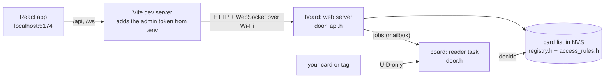

# Bench door app (R7)

A small React app that manages the cards of the `rfid-lab-r7` firmware: a bench door (simulated by the screen and the LED) on your ESP32 with the RC522.



The board keeps the list and decides every tap; the card only brings its UID. The app never holds the token: Vite's proxy adds it on your Mac.

## Run it

1. Flash the firmware: `cd test-esp && uv run pio run -e rfid-lab-r7 -t upload` (it uses the Wi-Fi network saved by W1/W2).
2. In the serial monitor type `token` and copy the value.
3. Then:

```sh
cd test-esp/door-app
cp .env.example .env       # BENCH_URL=http://bench.local (or the board's IP), BENCH_TOKEN=<token>
pnpm install
pnpm dev                   # http://localhost:5174
```

## What you can do

| In the app                                       | What the board does                                                                                                                 |
| ------------------------------------------------ | ----------------------------------------------------------------------------------------------------------------------------------- |
| **Add card** (name, role)                        | waits 20 s for a card it hasn't seen (screen: ADD A CARD, LED blinking blue) and adds it; guests start with 5 uses                  |
| **Block / Unblock**                              | a blocked card is refused before any other rule                                                                                     |
| **Edit** · hours, end date, uses, role           | the rules for the next tap; **presets**: Resident, Office hours, Night shift (across midnight), Weekend guest, One visit, Lost card |
| **Write name label** (card on the reader)        | name into block 4, role into block 5, read back; the door never trusts it                                                           |
| **Wipe card data** (card on the reader, confirm) | data blocks 4-6 and 8-10 back to zeros where the access bits allow; never keys, trailers or block 0                                 |
| **Remove from the list** (confirm)               | forgets the card; the card itself is untouched                                                                                      |
| **Open for 5 s**, **Lockdown**                   | remote open; only maintenance cards open during lockdown                                                                            |
| **Read the card on the reader**                  | UID, type, whether it is in the list, blocks 4-6 and 8-10                                                                           |

The rule order (`src/rfid-lab-r7/access_rules.h`, tested in `test/host/door_rules_test.cpp`): unknown → blocked → lockdown → no clock yet (fail closed) → expired → outside hours → no uses left → granted.

## Checks

```sh
pnpm typecheck
pnpm test        # rules.test.ts: rule text, dates, presets, what a save sends
```
